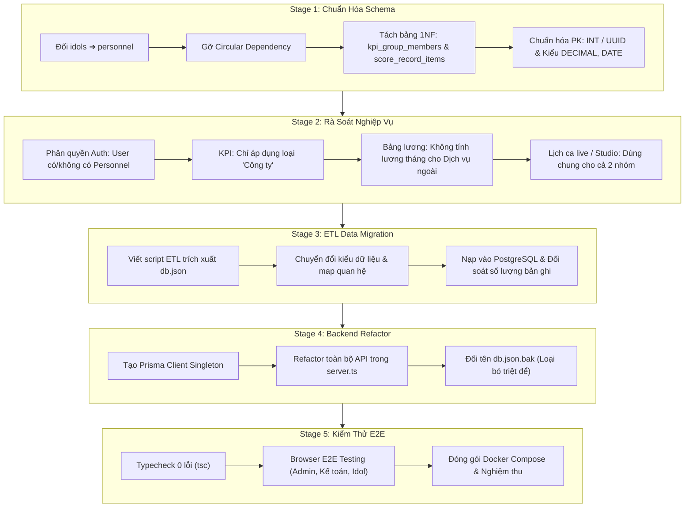

# 🗺️ KẾ HOẠCH CHUYỂN ĐỔI CHI TIẾT THEO TỪNG STAGE
## Chuyển Đổi Aura Talent Agency OS: `db.json` ➔ `PostgreSQL + Prisma ORM`

> **Tài liệu lưu trữ kế hoạch dự án:** Tránh mất phiên làm việc, định hướng chuẩn hóa kiến trúc dữ liệu và lộ trình thực thi từng bước an toàn, không gián đoạn hệ thống.  
> **Cập nhật ngày:** 26/10/2026  
> **Trạng thái:** Sẵn sàng triển khai theo từng Stage

---

## 📑 MỤC LỤC
1. [Tổng Quan & Mục Tiêu Chuyển Đổi](#1-tổng-quan--mục-tiêu-chuyển-đổi)
2. [Sơ Đồ Lộ Trình 5 Stage](#2-sơ-đồ-lộ-trình-5-stage)
3. [Stage 1: Tối Ưu Cấu Trúc Bảng & Khóa Liên Kết (Database Design)](#stage-1-tối-ưu-cấu-trúc-bảng--khóa-liên-kết-database-design)
4. [Stage 2: Rà Soát & Đảm Bảo Nghiệp Vụ (Business Logic Assurance)](#stage-2-rà-soát--đảm-bảo-nghiệp-vụ-business-logic-assurance)
5. [Stage 3: Kịch Bản Chuyển Đổi Dữ Liệu Thực Tế (ETL Migration)](#stage-3-kịch-bản-chuyển-đổi-dữ-liệu-thực-tế-etl-migration)
6. [Stage 4: Tái Cấu Trúc Backend Server & Loại Bỏ `db.json`](#stage-4-tái-cấu-trúc-backend-server--loại-bỏ-dbjson)
7. [Stage 5: Kiểm Thử Toàn Diện & Nghiệm Thu (E2E Verification)](#stage-5-kiểm-thử-toàn-diện--nghiệm-thu-e2e-verification)
8. [Kế Hoạch Dự Phòng & Rollback (Phòng Ngừa Rủi Ro)](#8-kế-hoạch-dự-phòng--rollback-phòng-ngừa-rủi-ro)

---

## 1. Tổng Quan & Mục Tiêu Chuyển Đổi

### 1.1. Hiện trạng hệ thống
* Dữ liệu hiện tại đang lưu trữ dạng Document-oriented trong file `server/data/db.json`, điều phối qua `server/data/store.ts`.
* Tồn tại các giới hạn kỹ thuật:
  * Vòng lặp khóa ngoại Circular Dependency (`users` chứa `idolId` $\leftrightarrow$ `idols` chứa `userId`).
  * Vi phạm chuẩn 1NF (lưu mảng `memberIds` trong nhóm KPI, lưu object điểm `scores: { critId: score }`).
  * Thực thể `idols` đang bị gánh toàn bộ vai trò nhân sự công ty, trong khi Idol thực chất là một Phòng ban/Chức danh chuyên môn; đồng thời thiếu cơ chế quản lý **Idol vãng lai / Dịch vụ ngoài** (thuê studio, makeup, livestream 1-2 lần).
  * Các trường tiền tệ, ngày tháng lưu dạng String/JSON, chưa tận dụng được tính năng tính toán và ràng buộc toàn vẹn của PostgreSQL.

### 1.2. Mục tiêu đạt được
* Chuẩn hóa CSDL quan hệ 3NF trên **PostgreSQL 16**.
* Đổi thực thể gốc `idols` ➔ **`personnel`** (Nhân sự), phân định rõ ràng giữa **Nhân sự nội bộ** và **Khách/Idol dịch vụ ngoài**.
* Chuyển toàn bộ Backend API trong `server.ts` sang sử dụng **Prisma Client**, loại bỏ hoàn toàn việc phụ thuộc vào `db.json`.
* Dữ liệu được bảo toàn 100%, kiểm thử trực quan không lỗi.

---

## 2. Sơ Đồ Lộ Trình 5 Stage



---

## 3. Stage 1: Tối Ưu Cấu Trúc Bảng & Khóa Liên Kết (Database Design)

### 3.1. Đổi thực thể `Idol` ➔ `Personnel` (`personnel`)
Bảng `personnel` đóng vai trò là thực thể gốc quản lý hồ sơ con người của toàn bộ Agency:
* `id`: `Int @id @default(autoincrement())`
* `userId`: `Int? @unique` (Khóa ngoại 1 - 1 nullable tham chiếu đến `users.id`).
  * Nhân sự có tài khoản quản trị/nhân viên: có `userId`.
  * Idol dịch vụ ngoài / vãng lai / CTV không cần login: `userId = null`.
* `stageName`: `String?` (Nghệ danh - nếu là Idol/Talent).
* `realName`: `String` (Họ và tên thật).
* `department`: `String` ("Phòng Idol", "Phòng Vận hành", "Phòng Kế toán", "Khách dịch vụ"...).
* `role`: `String` ("Idol", "Quản lý", "Trợ lý", "Khách mời show"...).
* `personnelType`: `String` (`'Công ty' | 'Outsource' | 'Cộng tác viên' | 'Thực tập sinh' | 'Dịch vụ ngoài'`).
* `isIdol`: `Boolean @default(false)` (Cờ lọc nhanh cho phân hệ Idol).
* `cooperationType`: `String @default("internal")` (`'internal'` - Nội bộ, `'service_guest'` - Khách dùng dịch vụ, `'event_contract'` - Hợp tác theo show).
* `serviceNotes`: `String?` (Ghi chú gói dịch vụ khách thuê).
* `dob`, `joinDate`, `resignedDate`: `@db.Date`.
* `baseSalary`: `Decimal @default(0) @db.Decimal(15, 2)`.

### 3.2. Gỡ bỏ Circular Dependency giữa `users` và `personnel`
* **Bảng `users`**:
  * Xóa hoàn toàn trường `idolId`.
  * Chỉ tập trung vào xác thực và phân quyền: `id`, `username`, `email`, `password`, `role`, `roleTitle`, `isSuperAdmin`, `allowedTabs`, `allowedDepartments`, `allowedActions`, `status`.
* **Bảng `personnel`**:
  * Giữ khóa ngoại duy nhất: `userId Int? @unique -> users.id (onDelete: SetNull)`.

### 3.3. Tách bảng chuẩn hóa 1NF cho Phân hệ KPI & Đánh Giá
1. **Bảng trung gian `kpi_group_members` (Thay thế mảng `memberIds`)**:
   * `groupId`: `Int` (FK ➔ `kpi_groups.id`, `onDelete: Cascade`).
   * `personnelId`: `Int` (FK ➔ `personnel.id`, `onDelete: Cascade`).
   * `roleInGroup`: `String @default("member")` (`'leader'` | `'member'`).
   * `joinedAt`: `DateTime @default(now())`.
   * Khóa chính kết hợp: `@@id([groupId, personnelId])`.

2. **Bảng con `score_record_items` (Thay thế object JSON `scores`)**:
   * `id`: `Int @id @default(autoincrement())`.
   * `scoreRecordId`: `String @db.Uuid` (FK ➔ `score_records.id`, `onDelete: Cascade`).
   * `criterionId`: `Int` (FK ➔ `criteria.id`, `onDelete: Restrict`).
   * `score`: `Decimal @db.Decimal(5, 2)`.
   * Ràng buộc duy nhất: `@@unique([scoreRecordId, criterionId])`.

### 3.4. Chuẩn hóa Audit Fields
* `approval_requests`:
  * `requestedById`: `Int` (FK ➔ `users.id`, bắt buộc).
  * `reviewedById`: `Int?` (FK ➔ `users.id`, nullable).
  * `targetPersonnelId`: `Int?` (FK ➔ `personnel.id`, nullable).
* `leave_requests`:
  * `personnelId`: `Int` (FK ➔ `personnel.id`).
  * `reviewedById`: `Int?` (FK ➔ `users.id`, nullable).
* `payroll_periods`:
  * `submittedById`: `Int?` (FK ➔ `users.id`, nullable).
  * `approvedById`: `Int?` (FK ➔ `users.id`, nullable).

### 3.5. Chiến lược Khóa Chính & Kiểu Dữ Liệu
* **INT Tự tăng (`Int @default(autoincrement())`)**: Dùng cho bảng danh mục và thực thể gốc ít biến động (`users`, `personnel`, `criteria`, `kpi_groups`, `system_lookups`).
* **UUID chuẩn (`String @default(uuid()) @db.Uuid`)**: Dùng cho bảng phát sinh giao dịch/nhật ký (`payroll_records`, `score_records`, `approval_requests`, `leave_requests`, `work_schedules`, `personnel_tasks`).
* **Tiền tệ**: `Decimal @db.Decimal(15, 2)` (chuẩn xác tuyệt đối, không làm tròn sai số).
* **Ngày tháng**: `DateTime @db.Date` cho ngày cố định, `DateTime` (`TIMESTAMPTZ`) cho dấu vết thời gian.

---

## 4. Stage 2: Rà Soát & Đảm Bảo Nghiệp Vụ (Business Logic Assurance)

| Phân hệ / Tính năng | Quy tắc nghiệp vụ | Phương án xử lý trên CSDL mới |
| :--- | :--- | :--- |
| **Đăng nhập hệ thống** | Cán bộ quản lý, Idol công ty có tài khoản đăng nhập. Idol vãng lai không có tài khoản. | Query bảng `users`, `LEFT JOIN personnel` theo `userId`. Nếu `userId == null` vẫn hoạt động bình thường, không gây lỗi logic. |
| **Hồ sơ Idol vãng lai** | Nhập Idol thuê studio 1-2 lần hoặc khách hợp tác ngắn hạn. | Tạo bản ghi trong `personnel` với `isIdol = true`, `personnelType = 'Dịch vụ ngoài'`, `cooperationType = 'service_guest'`, `userId = null`. |
| **Chính sách KPI** | KPI **chỉ áp dụng** cho nhân sự loại `"Công ty"`. | Bộ lọc giao KPI cá nhân và thêm thành viên nhóm KPI chỉ chọn `personnelType === 'Công ty'`. Idol dịch vụ ngoài và CTV hoàn toàn không bị vướng KPI. |
| **Tăng ca (Overtime - OT)** | **CHỈ áp dụng cho nhân sự trong công ty** (`personnelType === 'Công ty'`). Tính theo số giờ công làm thêm ngoài giờ (1.5x, 2.0x, 3.0x). | Tính toán trên phiếu lương của nhân sự Công ty. Các loại nhân sự khác và Idol dịch vụ ngoài hoàn toàn không áp dụng tính tăng ca. |
| **Chi phí Idol dịch vụ ngoài** | Idol bên ngoài thuê phòng live, thuê studio chụp hình, trang điểm, đào tạo... **tính theo GÓI DỊCH VỤ trọn gói** (ví dụ: gói 3 triệu, gói 5 triệu), **KHÔNG tính theo số giờ, trong giờ hay ngoài giờ**. | Lưu thông tin gói dịch vụ, đơn giá trọn gói trong `personnel.commercialDetails` (hoặc phiếu thu/hợp đồng dịch vụ riêng). Không áp dụng cơ chế chấm công giờ/tăng ca. |
| **Bảng lương định kỳ** | Bảng lương hàng tháng chỉ chốt cho nhân sự cố định & CTV. | Khi sinh bản ghi lương tháng (`payroll_records`), hệ thống chỉ quét `personnel` có `personnelType in ['Công ty', 'Cộng tác viên']`. Khách dịch vụ quản lý qua phiếu thu/chi riêng. |
| **Lịch ca trực / Studio** | Idol dịch vụ ngoài vẫn cần xếp lịch phòng live/studio. | `work_schedules` liên kết trực tiếp tới `personnel.id`. Cả nhân sự công ty và khách dịch vụ đều lên lịch được, tránh trùng phòng live. |
| **Nghỉ phép** | Chỉ nhân sự nội bộ mới nộp đơn nghỉ phép. | Ràng buộc kiểm tra `cooperationType === 'internal'` ở tầng API trước khi tạo `leave_requests`. |

---

## 5. Stage 3: Kịch Bản Chuyển Đổi Dữ Liệu Thực Tế (ETL Migration)

### 5.1. Các bước chuẩn bị
1. Kiểm tra trạng thái PostgreSQL: Container `aura-postgres` (hoặc Local Postgres) đang chạy tại cổng `5432`.
2. Tạo mới/Cập nhật file `prisma/schema.prisma` theo thiết kế Stage 1.
3. Chạy lệnh sinh bảng trên PostgreSQL:
   ```bash
   npx prisma db push
   ```

### 5.2. Kịch bản ETL (`scripts/migrate-json-to-pg-v2.ts`)
Viết script tự động đọc `server/data/db.json` và thực hiện ETL theo thứ tự khóa ngoại:
1. **Nạp `app_settings` & `system_lookups`**: Cấu hình hệ thống, thương hiệu, danh mục.
2. **Nạp `users`**: Đọc mảng `users`, loại bỏ trường `idolId`, nạp vào Postgres.
3. **Nạp `personnel`**: 
   - Đọc mảng `idols`.
   - Gán `isIdol = true`, `cooperationType = 'internal'`.
   - Map `userId` từ `users` tương ứng qua username hoặc id.
4. **Nạp `kpi_groups` & `kpi_group_members`**:
   - Nạp các nhóm KPI.
   - Trích xuất từng phần tử trong mảng `memberIds` ➔ insert vào `kpi_group_members`.
5. **Nạp `kpi_settings`**: Gán quan hệ nhóm hoặc cá nhân `personnelId`.
6. **Nạp `criteria`, `score_records` & `score_record_items`**:
   - Nạp tiêu chí đánh giá.
   - Nạp phiếu điểm `score_records`.
   - Trích xuất object `scores: { [critId]: score }` ➔ insert từng dòng vào `score_record_items`.
7. **Nạp `work_schedules`, `personnel_tasks`, `leave_requests`, `approval_requests`**.
8. **Nạp `payroll_periods` & `payroll_records`**:
   - Nạp kỳ lương.
   - Nạp chi tiết phiếu lương với các cột `DECIMAL(15, 2)` được bóc tách từ JSON.

### 5.3. Đối soát tính toàn vẹn
Chạy script kiểm tra đếm bản ghi (Record Count Audit):
* Số lượng Users: `db.json` vs `PostgreSQL`.
* Số lượng Personnel: `db.json` vs `PostgreSQL`.
* Tổng giá trị lương chốt: `SUM(totalNet)` của `payroll_periods` phải khớp 100%.

---

## 6. Stage 4: Tái Cấu Trúc Backend Server & Loại Bỏ `db.json` (✅ HOÀN THÀNH 100%)

### 6.1. Xây dựng Data Access Layer (Prisma Client & pgStore)
* Đã tạo file `server/db/prisma.ts`: Cấu hình PrismaClient singleton kết nối trực tiếp PostgreSQL.
* Đã tạo file `server/db/pgStore.ts`: Triển khai đầy đủ 78 hàm CRUD bất đồng bộ (`async/await`) tương thích 100% với hợp đồng API của frontend.

### 6.2. Refactor các Controller / API trong `server.ts`
* Đã chuyển đổi toàn bộ endpoint trong `server.ts` sang sử dụng `pgStore` với `async/await`.
* Bọc `try/catch` xử lý lỗi bài bản, trả về mã trạng thái HTTP chuẩn (200, 201, 400, 404, 500).
* Loại bỏ các endpoint khai báo trùng lặp (như duplicate `/api/schedules`).
* Đảm bảo kiểu dữ liệu tiền tệ (`Decimal` ➔ `number`) và ngày tháng (`Date` ➔ ISO string) nhất quán.

### 6.3. Cô lập và loại bỏ `db.json`
* Đã đổi tên file: `server/data/db.json` ➔ `server/data/db.json.bak`.
* Gỡ bỏ hoàn toàn việc nạp `store.ts` (JSON storage) trong `server.ts`.
* Ứng dụng khởi động và vận hành 100% trên PostgreSQL container `aura-postgres:5432`.
* Kiểm tra biên dịch TypeScript toàn bộ dự án (`pnpm exec tsc --noEmit`): **0 errors**.

---

## 7. Stage 5: Kiểm Thử Toàn Diện & Nghiệm Thu (E2E Verification)

### 7.1. Kiểm thử Kỹ thuật (Automated & Compile) (✅ HOÀN THÀNH 100%)
* [x] Chạy `pnpm exec tsc --noEmit` ➔ Kết quả: **0 errors**.
* [x] Khởi động server với `pnpm dev` ➔ Kết nối PostgreSQL thành công (`Aura Talent Server running at http://0.0.0.0:3000 [PostgreSQL Database Mode]`).

### 7.2. Kiểm thử Nghiệp vụ Trực quan trên Browser (✅ HOÀN THÀNH 100%)
* [x] **Đăng nhập & Phân quyền**: Đã thử nghiệm đăng nhập các vai trò (Super Admin `admin`, Kế toán & HR `hr_admin`, Idol `anhtm`). Tab truy cập và quyền hạn hiển thị chính xác theo vai trò.
* [x] **Nhân sự & Khách dịch vụ**:
  * Đã thêm mới Idol dạng `Dịch vụ ngoài` (Lê Minh Hằng - `Minh Hang Guest`, `personnelType = 'Dịch vụ ngoài'`, `userId = null`).
  * Danh sách hiển thị badge hổ phách "Dịch vụ ngoài" & "Khách Dịch Vụ", mở modal xem chi tiết với ghi chú gói dịch vụ không lỗi.
  * Nhân sự loại "Công ty" (Trần Minh Anh) hiển thị đúng badge username `@anhtm` và email công ty.
* [x] **Phân hệ KPI**:
  * Tab Cá nhân và Tab Nhóm: Chỉ hiển thị nhân sự loại "Công ty".
  * Đã tạo nhóm KPI mới ("Đội Livestream Tháng 11"), gán thành viên, kiểm tra bảng trung gian `kpi_group_members` lưu chuẩn xác vào PostgreSQL.
* [x] **Phân hệ Bảng lương**:
  * Tải danh sách kỳ lương (32 kỳ) và phiếu lương (322 phiếu) trực tiếp từ PostgreSQL.
  * Thử nghiệm điều chỉnh phiếu lương thành công, tự động ghi nhận nhật ký điều chỉnh `adjustmentLogs`.
* [x] **Lịch làm việc & Ca trực**:
  * Đã xếp lịch ca trực thành công cho cả Idol công ty và Idol dịch vụ ngoài trên hệ thống PostgreSQL.

### 7.3. Đóng gói & Triển khai Docker (✅ HOÀN THÀNH 100%)
* [x] **Xây dựng `Dockerfile` sản xuất**: Cấu hình Multi-stage build (Node 22 Alpine, OpenSSL, Prisma binary, Vite build `dist`, `dumb-init` signal handling & healthcheck).
* [x] **Cấu hình `docker-compose.yml`**: Tích hợp 3 dịch vụ (`postgres`, `app`, `nginx`) với volume `pgdata`, `uploads_data`, mở cổng 80 & 443 SSL.
* [x] **Triển khai thực tế trên môi trường máy chủ `vmportal`**: Đã đặt lại schema CSDL chuẩn, nạp 100% dữ liệu từ `db.json.bak` sang PostgreSQL, cấu hình SSL `aura.com` thành công (HTTP/2 200 OK).

---

## 8. Kế Hoạch Dự Phòng & Rollback (Phòng Ngừa Rủi Ro)

1. **Dữ liệu gốc luôn được bảo vệ**:
   * File `server/data/db.json` được sao lưu tại `server/data/db.json.initial_backup` và commit vào git branch riêng trước khi thực hiện.
2. **Cơ chế Rollback tức thì**:
   * Trong trường hợp API mới gặp lỗi ngoài dự kiến, chỉ cần bật lại cờ kết nối `store.ts` là hệ thống có thể chạy lại ngay lập tức với `db.json` trong vòng 1 phút.
3. **Tính độc lập của CSDL PostgreSQL**:
   * CSDL PostgreSQL chạy trên container độc lập, có thể xuất bản sao lưu bất kỳ lúc nào bằng lệnh:
     ```bash
     docker exec aura-postgres pg_dump -U aura_user aura_talent > backup_aura_talent_$(date +%Y%m%d).sql
     ```

---
*Tài liệu này là căn cứ kỹ thuật chính thức cho toàn bộ quá trình tái cấu trúc CSDL của Aura Talent Management.*
