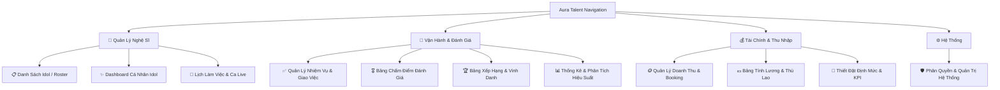

# Đề Xuất Cải Tiến Cấu Trúc Menu Điều Hướng (Navigation Architecture)
## Hệ Thống Quản Trị Idol & Nhân Sự - Aura Talent Management

---

## 1. Đặt Vấn Đề & Hiện Trạng

### 1.1 Hiện trạng Menu hiện tại
Thanh điều hướng trên cùng (Top Navbar) hiện đang hiển thị **11 chức năng dàn trải ngang hàng**:
```
[Danh Sách (14)]  [Dashboard Idol]  [Bảng Điểm]  [Xếp Hạng]  [Lịch Làm Việc]  [Nhiệm Vụ]  [Thống Kê]  [Doanh Thu]  [Bảng Lương]  [Thiết Đặt KPI]  [Quản Trị]
```

### 1.2 Nhược điểm chính
1. **Quá tải thị giác (Cognitive Overload):** Người dùng phải đọc qua 11 nút bấm khác nhau để tìm chức năng mình cần.
2. **Chiếm dụng không gian ngang:** Trên màn hình laptop (13" - 15") hoặc khi thu nhỏ cửa sổ, thanh menu bị chật chội, tràn nút hoặc che khuất thanh Tìm Kiếm (Universal Search) và Thông tin tài khoản.
3. **Thiếu tính phân cấp nghiệp vụ:** Không phân biệt được đâu là công cụ vận hành hàng ngày (Lịch, Task), đâu là công cụ đánh giá (Điểm, Xếp hạng), đâu là tài chính (Doanh thu, Lương), và đâu là cấu hình hệ thống.

---

## 2. Bản Đồ Phân Nhóm Nghiệp Vụ Mới (Information Architecture)

Toàn bộ 11 chức năng được tái cấu trúc thành **4 Nhóm Nghiệp Vụ Chuẩn Hóa**:



### Chi tiết 4 Nhóm Chức Năng:

| Nhóm Menu | Icon Đại Diện | Các Chức Năng Con (Sub-items) | Đối Tượng Sử Dụng Thường Xuyên |
| :--- | :---: | :--- | :--- |
| **1. Quản Lý Nghệ Sĩ**<br>*(Talent Hub)* | `Users` | • **Danh Sách Nghệ Sĩ** (`roster`): Hồ sơ, hợp đồng, thực tập sinh, lọc phòng ban.<br>• **Dashboard Idol** (`my_dashboard`): Không gian cá nhân của Idol.<br>• **Lịch Làm Việc** (`schedule`): Ca live, sự kiện, booking nhãn hàng. | Toàn bộ nhân sự, Quản lý Idol, Idol |
| **2. Vận Hành & Đánh Giá**<br>*(Operations & Performance)* | `Award` / `Activity` | • **Quản Lý Nhiệm Vụ** (`tasks`): Giao việc, deadline, phê duyệt kết quả.<br>• **Bảng Điểm Đánh Giá** (`scoring`): Chấm điểm hàng tháng theo tiêu chí.<br>• **Bảng Xếp Hạng** (`leaderboard`): Vinh danh Top Idol, Tier xếp hạng.<br>• **Thống Kê Hiệu Suất** (`analytics`): Biểu đồ tăng trưởng, xu hướng phòng ban. | Quản lý, Giám sát, Ban Giám Đốc |
| **3. Tài Chính & Thu Nhập**<br>*(Finance & Payroll)* | `Banknote` / `Coins` | • **Quản Lý Doanh Thu** (`revenue`): Booking nhãn hàng, hoa hồng sàn, đợt thanh toán.<br>• **Bảng Tính Lương** (`payroll`): Bảng lương tháng, tạm ứng, khấu trừ, xuất phiếu lương.<br>• **Thiết Đặt KPI** (`kpi`): Định mức doanh thu, giờ live, cơ chế thưởng vượt mức. | Kế toán, HR C&B, Giám Đốc |
| **4. Hệ Thống**<br>*(Admin & Settings)* | `Shield` | • **Quản Trị Hệ Thống** (`admin`): Phân quyền tài khoản, cấu hình phòng ban, trạng thái, audit logs. *(Hiển thị kèm badge thông báo phê duyệt chờ xử lý).* | Super Admin, IT Admin |

---

## 3. Các Phương Án Thiết Kế Giao Diện (UI Mockups)

### 🌟 Phương Án 1 (Khuyến Nghị): Top Navbar với Dropdown Menu Hiện Đại
> Giữ nguyên phong cách Header ngang nhưng gom 11 nút thành **4 nút Nhóm có Menu Thả Xuống (Dropdown Popover)** mượt mà, cao cấp:

```
+-------------------------------------------------------------------------------------------------------------------------+
| [AURA TALENT]   [👥 Nghệ Sĩ ▾]   [🎯 Vận Hành ▾]   [💰 Tài Chính ▾]   [⚙️ Quản Trị (3)]   | 🔍 Tìm kiếm... | [Avatar Admin] |
+-------------------------------------------------------------------------------------------------------------------------+
```

*Khi di chuột hoặc bấm vào **[💰 Tài Chính ▾]**, menu xổ xuống sang trọng:*
```
┌────────────────────────────────────────────────────────┐
│  💰 TÀI CHÍNH & THU NHẬP                               │
├────────────────────────────────────────────────────────┤
│  🪙  Quản Lý Doanh Thu                                 │
│      Booking nhãn hàng, hoa hồng sàn, đợt thanh toán   │
├────────────────────────────────────────────────────────┤
│  💵  Bảng Tính Lương & Thù Lao                         │
│      Phiếu lương idol, tạm ứng, khấu trừ & chi trả     │
├────────────────────────────────────────────────────────┤
│  🎯  Thiết Đặt Định Mức & KPI                          │
│      Chỉ tiêu doanh thu, giờ live & thưởng hiệu suất   │
└────────────────────────────────────────────────────────┘
```
- **Ưu điểm:**
  - Cực kỳ gọn gàng, giảm từ 11 nút xuống còn 4 nút chính.
  - Phù hợp hoàn hảo với màn hình mọi kích thước, không bao giờ bị tràn.
  - Tích hợp mô tả phụ (sub-title) trong dropdown giúp người dùng mới hiểu ngay chức năng.
  - Vẫn giữ nguyên layout nội dung bên dưới mà không làm thay đổi thói quen sử dụng.

---

### 🌟 Phương Án 2: Thanh Điều Hướng 2 Tầng (Two-Tier Navigation)
> Tầng trên là các Nhóm lớn; tầng dưới tự động hiển thị các Tab con của nhóm đang chọn:

```
+-------------------------------------------------------------------------------------------------------------------------+
| [AURA TALENT]   (👥 Nghệ Sĩ)   [🎯 Vận Hành]   [💰 Tài Chính]   [⚙️ Quản Trị]             | 🔍 Tìm kiếm... | [Avatar Admin] |
+-------------------------------------------------------------------------------------------------------------------------+
|    ↳  [📋 Danh Sách (14)]     [✨ Dashboard Idol]     [📅 Lịch Làm Việc]                                                |
+-------------------------------------------------------------------------------------------------------------------------+
```
- **Ưu điểm:** Chuyển đổi 1-click giữa các tab con mà không cần hover dropdown.
- **Nhược điểm:** Tốn thêm ~36px chiều cao của màn hình cho thanh phụ (sub-bar).

---

### 🌟 Phương Án 3: Menu Cột Dọc Thu Gọn (Modern Collapsible Sidebar)
> Chuyển toàn bộ menu sang thanh bên trái (Sidebar) dạng Accordion / Nhóm:

```
+--------------------+----------------------------------------------------------------------------------------------------+
| [AURA TALENT]      | Header: [Breadcrumb / Thanh tìm kiếm nhanh]                                         [Avatar Admin] |
| ------------------ | -------------------------------------------------------------------------------------------------- |
| 👥 NGHỆ SĨ         |                                                                                                    |
|   • Danh sách (14) |                                                                                                    |
|   • Dashboard Idol |                                    [ KHÔNG GIAN LÀM VIỆC CHÍNH ]                                   |
|   • Lịch làm việc  |                                                                                                    |
| 🎯 VẬN HÀNH        |                                                                                                    |
|   • Nhiệm vụ       |                                                                                                    |
|   • Bảng điểm      |                                                                                                    |
|   • Xếp hạng       |                                                                                                    |
|   • Thống kê       |                                                                                                    |
| 💰 TÀI CHÍNH       |                                                                                                    |
|   • Doanh thu      |                                                                                                    |
|   • Bảng lương     |                                                                                                    |
|   • Thiết đặt KPI  |                                                                                                    |
| ⚙️ HỆ THỐNG        |                                                                                                    |
|   • Quản trị (3)   |                                                                                                    |
+--------------------+----------------------------------------------------------------------------------------------------+
```
- **Ưu điểm:** Trực quan kiểu các phần mềm Enterprise/SaaS lớn (Notion, Jira, Linear).
- **Nhược điểm:** Thay đổi bố cục ngang sang dọc, cần điều chỉnh layout toàn bộ các trang con.

---

## 4. Phân Quyền Hiển Thị Tự Động (Smart Role-Based Visibility)

Mỗi nhóm menu sẽ tự động ẩn/hiện dựa trên quyền hạn thực tế của người dùng:
1. **Đối với Nghệ Sĩ / Idol đăng nhập:**
   - Chỉ thấy nhóm **👥 Quản Lý Nghệ Sĩ** (với Dashboard cá nhân & Lịch làm việc) + Nhóm **🎯 Vận Hành** (Nhiệm vụ của mình).
   - Ẩn hoàn toàn nhóm **💰 Tài Chính** (hoặc chỉ xem được phiếu lương cá nhân) và nhóm **⚙️ Quản Trị**.
2. **Đối với Quản Lý Đội Nhóm (Manager / Leader):**
   - Thấy nhóm **👥 Nghệ Sĩ**, **🎯 Vận Hành**, và **🎯 Thiết Đặt KPI**.
3. **Đối với Kế Toán / Nhân Sự (Accountant / HR):**
   - Hiển thị nổi bật nhóm **💰 Tài Chính** và danh sách Idol.
4. **Đối với Giám Đốc / Super Admin:**
   - Toàn quyền truy cập đầy đủ cả 4 nhóm.

---

## 5. Đề Xuất Lựa Chọn & Lộ Trình Triển Khai

> **Đề xuất thực hiện:** Áp dụng **Phương Án 1 (Top Navbar với Dropdown Nhóm Hiện Đại)** vì:
> 1. Giải quyết triệt để vấn đề dàn hàng ngang nhiều nút.
> 2. Đẹp mắt, chuyên nghiệp, giữ nguyên diện tích màn hình làm việc tối đa.
> 3. Tương thích 100% với toàn bộ code hiện tại, không gây ảnh hưởng đến dữ liệu hay các view hiện có.
