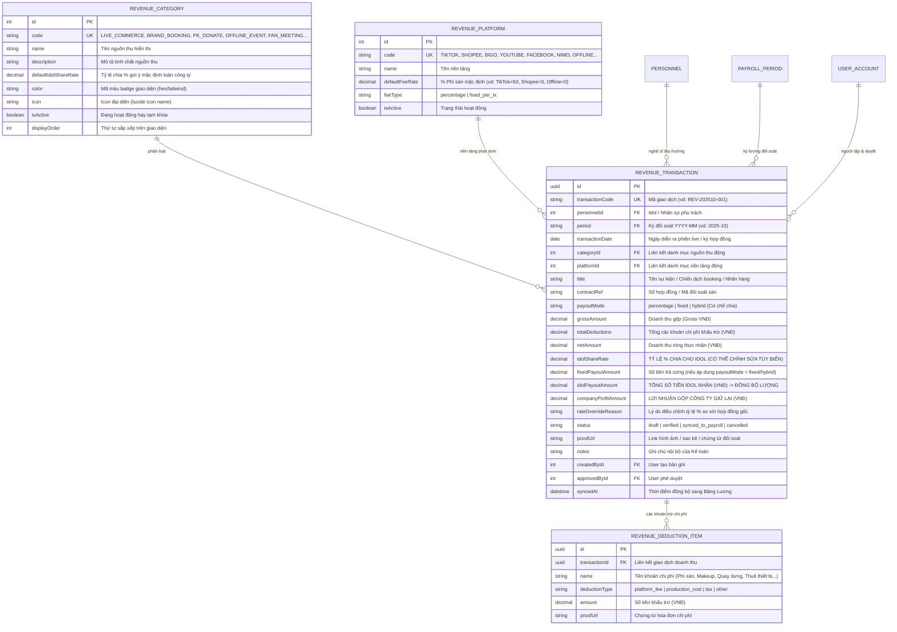

# Đề Xuất & Phác Thảo Thiết Kế: Phân Hệ Quản Lý Doanh Thu (Revenue Management)
**Hệ Thống Quản Lý Idol & Nhân Sự Nghệ Thuật — Aura Talent Agency OS**

> **Tài liệu đề xuất kỹ thuật & giao diện (Technical & UI/UX Proposal) — Phiên bản 2.0 (Dynamic & Zero-Hardcode)**  
> **Trạng thái:** Bổ sung theo yêu cầu: *Tỷ lệ chia % Idol cho Booking chỉnh sửa linh hoạt; Tuyệt đối không hardcode các thành phần động.*  
> **Mục tiêu:** Xây dựng module quản lý nguồn thu toàn diện, cấu hình hóa 100% các tham số kinh doanh, tự động tính toán và đồng bộ trực tiếp sang Bảng Lương (Payroll) & KPI.

---

## 1. Nguyên Tắc Cốt Lõi: Thiết Kế Động — Không Hardcode (Zero-Hardcoding Architecture)

Để đảm bảo hệ thống thích ứng lâu dài với mọi mô hình hợp đồng và sự biến động của ngành công nghiệp giải trí/livestream, toàn bộ hệ thống tuân thủ **nguyên tắc không hardcode**:

1. **Tỷ lệ chia % cho Idol (Idol Share %):** 
   - Không cố định con số nào trong mã nguồn.
   - Hỗ trợ **3 cấp độ linh hoạt**: (1) Tỷ lệ mặc định theo hợp đồng của Idol ➔ (2) Ghi đè (override) tùy biến trên từng Hợp đồng Booking/Phiên live cụ thể ➔ (3) Hỗ trợ cả 2 mô hình: Chia theo % hoặc Trả thù lao cố định (Fixed Fee), hoặc Kết hợp (Cố định + % Hoa hồng).
2. **Danh mục Nguồn Thu (Revenue Categories):**
   - Được quản lý bằng bảng CSDL riêng. Ban Quản Trị có thể tự thêm nguồn thu mới bất kỳ lúc nào (ví dụ sau này mở thêm: *Bán vé Fan Meeting, Bán Merchandise/Vật phẩm, Khóa đào tạo Idol tân binh, Bản quyền âm nhạc...*) mà không cần sửa code.
3. **Danh mục Nền Tảng (Platforms):**
   - Quản lý động qua bảng CSDL. Thêm mới nền tảng (TikTok, Shopee, Bigo, YouTube, Nimo, Facebook, Offline, VNPAY...) kèm cấu hình **% Phí sàn mặc định** có thể điều chỉnh bất kỳ lúc nào.
4. **Các Khoản Khấu Trừ Trước Chia (Deductible Costs):**
   - Không giới hạn ở mỗi "phí sàn", mà cho phép gắn các khoản chi phí phát sinh thực tế vào từng hợp đồng (Ví dụ: Chi phí trang phục/makeup, chi phí quay dựng TVC, hoa hồng môi giới đối tác...).
5. **Trạng thái vòng đời & Quy trình duyệt (Lifecycle Statuses):**
   - Cấu hình qua bảng tham số hệ thống (Nháp ➔ Chờ đối soát ➔ Đã duyệt ➔ Đã đồng bộ sang Bảng Lương ➔ Đã thanh toán).

---

## 2. Mô Hình Phân Chia Doanh Thu Đa Cấp Độ (Flexible Revenue Split Matrix)

### 2.1. 3 Cấp độ xác định Tỷ lệ chia % cho Idol

```
[ CẤP 1: TỶ LỆ HỢP ĐỒNG GỐC CỦA IDOL ]
  Cấu hình trong Hồ sơ Nhân sự (personnel.contractDetails):
  • Tỷ lệ mặc định Booking: 70%
  • Tỷ lệ mặc định Live Commerce: 50%
  • Tỷ lệ mặc định PK/Donate: 65%
            │
            ▼ (Khi tạo mới một Hợp đồng Booking hoặc Phiên Live)
[ CẤP 2: TỰ ĐỘNG GỢI Ý & CHO PHÉP GHI ĐÈ TRỰC TIẾP TRÊN GIAO DỊCH ]
  Hệ thống tự động điền tỷ lệ mặc định từ Cấp 1, nhưng Kế toán/Quản lý có thể:
  • SỬA TRỰC TIẾP % CHIA (Vd: Hợp đồng nhãn hàng A chia 75%, nhãn hàng B chỉ chia 60%)
  • CHUYỂN ĐỔI CHẾ ĐỘ:
      (a) Chia theo % Doanh thu ròng (% Split)
      (b) Cát-sê cố định trọn gói (Fixed Payout - ví dụ trả cứng 15,000,000đ)
      (c) Kết hợp: Lương cứng phiên + % Thưởng vượt KPI doanh số
            │
            ▼
[ CẤP 3: LƯU TRỮ VẾT ĐIỀU CHỈNH (AUDIT TRAIL) ]
  • Ghi nhận User thực hiện thay đổi, ngày giờ và Lý do điều chỉnh (Vd: "Phê duyệt ưu đãi chiến dịch Tết theo quyết định BGĐ số 12").
```

### 2.2. Công thức tính toán động (Dynamic Calculation Flow)

$$\text{Doanh Thu Gộp (Gross GMV / Contract Value)}$$
$$\downarrow$$
$$\mathbf{(-)} \sum \text{Các Khoản Chi Phí & Khấu Trừ Hợp Lệ} \quad \begin{cases} \text{Phí nền tảng (Platform Fee - vd: TikTok 50\%, Shopee 5\%)} \\ \text{Chi phí sản xuất / Makeup / Studio phát sinh (nếu có)} \\ \text{Thuế / Phí chuyển tiền (nếu có)} \end{cases}$$
$$\downarrow$$
$$\text{Doanh Thu Ròng Thực Nhận (Net Cash Inflow)}$$
$$\swarrow \qquad \qquad \qquad \searrow$$
$$\begin{aligned} &\textbf{Phần Idol Hưởng (Idol Payout)} \\ &= \begin{cases} \text{Net} \times \% \text{ Chia chỉnh sửa theo deal} \\ \text{HOẶC Số tiền cố định theo thỏa thuận} \end{cases} \\ &\Rightarrow \textbf{Tự động đẩy sang Bảng Lương (Payroll)} \end{aligned} \qquad \qquad \begin{aligned} &\textbf{Lợi Nhuận Gộp Công Ty (Agency Margin)} \\ &= \text{Net} - \text{Phần Idol Hưởng} \\ &\Rightarrow \textbf{Ghi nhận Doanh Thu Thuần của Aura Talent} \end{aligned}$$

---

### 2.3. Quản Lý Tiến Độ Thanh Toán Đa Dạng Của Nhãn Hàng (Payment Milestones & Tranches)

Trong thực tế, các hợp đồng nhãn hàng thuê Idol theo tháng, cả năm hoặc chiến dịch có **rất nhiều hình thức thanh toán khác nhau**. Hệ thống hỗ trợ đầy đủ **4 kịch bản thanh toán linh hoạt**:

```
[ HỢP ĐỒNG NHÃN HÀNG / BOOKING TRỌN GÓI ]
                        │
 ┌──────────────────────┼──────────────────────┬──────────────────────┐
 ▼                      ▼                      ▼                      ▼
[ KỊCH BẢN 1 ]         [ KỊCH BẢN 2 ]         [ KỊCH BẢN 3 ]         [ KỊCH BẢN 4 ]
TRẢ FULL 1 LẦN         TRẢ THEO 2 ĐỢT         TRẢ THEO 3 ĐỢT         TRẢ ĐỊNH KỲ THÁNG
(100% Single Payout)   (2 Tranches: 50-50 /   (3 Tranches: 30-40-30) (Monthly Retainer)
                       30-70)
• Trả trước (Cọc 100%) • Đợt 1: Cọc khi ký    • Đợt 1: Cọc 30% khi   • Hợp đồng 3, 6, 12 tháng.
• Trả giữa chiến dịch  • Đợt 2: Quyết toán       ký hợp đồng          • Chia đều số tiền vào
• Trả sau (Nghiệm thu    sau khi kết thúc     • Đợt 2: 40% giữa kỳ      từng tháng.
  xong mới thanh toán)   chiến dịch           • Đợt 3: 30% nghiệm thu • Mỗi tháng tự động sync
                                                                        vào lương tháng đó.
```

#### Chi tiết cơ chế vận hành từng đợt thanh toán:
1. **Gắn từng đợt thanh toán vào đúng Kỳ Lương (Period Mapping)**:
   - Ví dụ hợp đồng tài trợ 3 tháng trị giá **150,000,000 VNĐ** (từ T10 đến T12/2025), nhãn hàng chọn trả 3 đợt (30% - 40% - 30%):
     * *Đợt 1 (30% = 45,000,000đ)*: Thanh toán vào 10/10/2025 ➔ Gắn vào **Kỳ Lương 2025-10** (Idol nhận hoa hồng tương ứng trong lương Tháng 10).
     * *Đợt 2 (40% = 60,000,000đ)*: Thanh toán vào 15/11/2025 ➔ Gắn vào **Kỳ Lương 2025-11** (Idol nhận hoa hồng trong lương Tháng 11).
     * *Đợt 3 (30% = 45,000,000đ)*: Thanh toán vào 20/12/2025 ➔ Gắn vào **Kỳ Lương 2025-12** (Idol nhận hoa hồng trong lương Tháng 12).
2. **Bảo vệ dòng tiền Agency (Cashflow Protection Rule)**:
   - Mỗi đợt có trạng thái: `⏳ Chờ nhãn hàng thanh toán (Pending)` ➔ `💵 Đã nhận tiền từ Brand (Paid)` ➔ `🔄 Đã đồng bộ Lương (Synced)`.
   - **Nguyên tắc tài chính chuẩn:** Chỉ những đợt mà nhãn hàng **đã thanh toán thực tế về tài khoản công ty** mới được phép đồng bộ hoa hồng sang Bảng Lương của Idol, tránh rủi ro Agency phải ứng tiền túi trả Idol trước khi nhãn hàng nợ đọng hoặc quỵt tiền.
   - *Ngoại lệ:* Nếu Ban Giám Đốc phê duyệt chính sách "Tạm ứng thù lao Idol trước", hệ thống cho phép bật cờ `Bảo lãnh chi trả trước`.
3. **Mẫu cấu hình thanh toán nhanh (One-Click Presets)**:
   - Khi tạo hợp đồng, Kế toán chỉ cần bấm 1 nút để chọn nhanh:
     * `[Trả Full Trước: 100% Cọc]` (Tiền về trước khi chạy live/chiến dịch)
     * `[Trả Full Giữa Kỳ: 100%]` (Thanh toán giữa chiến dịch)
     * `[Trả Full Sau: 100% Nghiệm thu]` (Thanh toán sau khi kết thúc)
     * `[Trả 2 đợt: 50% - 50%]` (50% Tạm ứng - 50% Nghiệm thu)
     * `[Trả 3 đợt: 30% - 40% - 30%]` (30% Cọc - 40% Giữa kỳ - 30% Nghiệm thu)
     * `[Theo Tháng: 3 Tháng / 6 Tháng / 12 Tháng Cả Năm]` (Thuê live định kỳ đều hàng tháng)
     * `[Tự do thêm N đợt tùy chỉnh]` (Cho phép sửa %, số tiền, kỳ tháng cho từng đợt)

---

---

## 3. Kiến Trúc CSDL Chuẩn Hóa Không Hardcode (PostgreSQL Schema)

Hệ thống bổ sung các bảng danh mục động (`revenue_categories`, `revenue_platforms`) và bảng nghiệp vụ giao dịch (`revenue_transactions`, `revenue_deduction_items`):



---

## 4. Phác Thảo Giao Diện Người Dùng (UI/UX Mockup)

### 4.1. Màn hình chính phân hệ: `RevenueManagementView.tsx`

```
┌────────────────────────────────────────────────────────────────────────────────────────────────────────┐
│ 💰 QUẢN LÝ DOANH THU & ĐỐI SOÁT HOA HỒNG (AURA TALENT OS)                                             │
│ Quản lý doanh số bán hàng, quà PK, hợp đồng Booking & phân bổ thù lao Idol (Tùy biến 100% không fix cứng)│
├────────────────────────────────────────────────────────────────────────────────────────────────────────┤
│ [ KHU VỰC A: 4 THẺ TÀI CHÍNH TỔNG QUAN ]                                                              │
│ ┌──────────────────┐  ┌──────────────────┐  ┌──────────────────┐  ┌──────────────────┐                 │
│ │ 💵 Tổng Doanh Thu│  │ 🏢 Lợi Nhuận Cty │  │ 🎁 Hoa Hồng Idol │  │ 📈 Tăng Trưởng   │                 │
│ │  1,250,000,000đ  │  │   450,000,000đ   │  │   800,000,000đ   │  │   +18.5% so T9   │                 │
│ │ (Doanh thu ròng) │  │ (Biên lợi nhuận) │  │ (Đồng bộ Lương)  │  │ (So mục tiêu KPI)│                 │
│ └──────────────────┘  └──────────────────┘  └──────────────────┘  └──────────────────┘                 │
├────────────────────────────────────────────────────────────────────────────────────────────────────────┤
│ [ KHU VỰC B: BỘ LỌC ĐA CHIỀU & CÁC NÚT TÁC VỤ ]                                                       │
│ [🔍 Tìm Idol/Hợp đồng...] [Kỳ: Tháng 10/2025 ▾] [Nguồn thu: Tất cả ▾] [Nền tảng: Tất cả ▾]             │
│                                                                                                        │
│  [⚙️ Quản Lý Nguồn Thu & Nền Tảng]  [📥 Nhập File Excel Sàn]  [🔄 Đồng Bộ Sang Lương]  [➕ Thêm Giao Dịch]│
├────────────────────────────────────────────────────────────────────────────────────────────────────────┤
│ [ KHU VỰC C: BẢNG DỮ LIỆU ĐỐI SOÁT DOANH THU (DATA GRID) ]                                             │
│                                                                                                        │
│ STT | Ngày      | Nghệ Sĩ / Idol    | Nguồn Thu     | Nền Tảng | Doanh Thu Gộp | Doanh Thu Ròng | Tỷ Lệ % Chia     | Tiền Idol Nhận | Lãi Cty     | Trạng Thái     | Thao Tác │
│ 01  | 25/10/2025| Minh Anh (Aria)   | Quà PK Live   | TikTok   | 50,000,000đ   | 25,000,000đ    | 70% (Theo HĐ)    | 17,500,000đ    | 7,500,000đ  | ✅ Đã duyệt    | ✏️ 👁️ 🗑️│
│ 02  | 24/10/2025| Khánh An (Kenzo)  | Brand Booking | YouTube  | 40,000,000đ   | 36,000,000đ    | 65% ➔ 80% (Sửa)  | 28,800,000đ    | 7,200,000đ  | ✅ Đã duyệt    | ✏️ 👁️ 🗑️│
│ 03  | 22/10/2025| Luna Đoàn         | Live Commerce | Shopee   | 100,000,000đ  | 15,000,000đ    | 50% (Theo HĐ)    |  7,500,000đ    | 7,500,000đ  | 🔄 Đã sync Lương| ✏️ 👁️ 🗑️│
│ 04  | 20/10/2025| Chloe Vũ          | Brand Booking | Event    | 20,000,000đ   | 18,000,000đ    | Cát-sê cứng: 12tr| 12,000,000đ    | 6,000,000đ  | ⏳ Chờ đối soát| ✏️ 👁️ 🗑️│
│                                                                                                        │
│ Tổng hoa hồng đã duyệt kỳ này: 65,800,000 VNĐ  •  Chưa đồng bộ sang lương: 46,300,000 VNĐ               │
└────────────────────────────────────────────────────────────────────────────────────────────────────────┘
```

---

### 4.2. Modal Thêm / Chỉnh Sửa Giao Dịch Doanh Thu & Booking (Transaction Modal)

Đây là nơi hiện thực hóa yêu cầu: **Cho phép chỉnh sửa linh hoạt tỷ lệ % chia cho Idol theo từng hợp đồng booking cụ thể, hiển thị preview tức thì**:

```
┌────────────────────────────────────────────────────────────────────────┐
│ ➕ THÊM / CẬP NHẬT GIAO DỊCH DOANH THU & BOOKING                       │
├────────────────────────────────────────────────────────────────────────┤
│ 1. THÔNG TIN CHUNG                                                     │
│ • Nghệ sĩ / Idol:       [ Minh Anh (Aria) - Khối Idol Biểu Diễn ▾ ]    │
│ • Nguồn thu (Category): [ 🏷️ Brand Booking & Hợp Đồng Nhãn Hàng ▾ ]   │
│ • Nền tảng (Platform):  [ 📺 YouTube Sponsor / TVC ▾ ]                │
│ • Tên chiến dịch/HĐ:    [ Review Bàn Phím Cơ Asus ROG & Post Video   ] │
│ • Ngày diễn ra:         [ 25/10/2025 ]      Mã HĐ: [ HD-2025-ASUS-01 ] │
├────────────────────────────────────────────────────────────────────────┤
│ 2. SỐ LIỆU TÀI CHÍNH & CHI PHÍ KHẤU TRỪ                                │
│ • Doanh thu gộp (Gross):   [ 50,000,000 ] VNĐ                          │
│ • Các khoản chi phí khấu trừ:                                         │
│   - Phí sàn / Đại lý quảng cáo: [  5,000,000 ] VNĐ                     │
│   - Chi phí quay dựng / Studio: [  3,000,000 ] VNĐ                     │
│   ➔ Doanh thu ròng (Net):       [ 42,000,000 ] VNĐ (Tự động tính)      │
├────────────────────────────────────────────────────────────────────────┤
│ 3. CƠ CHẾ PHÂN CHIA THÙ LAO IDOL (HOÀN TOÀN TÙY CHỈNH)                 │
│ • Cơ chế tính: (•) Chia theo %     ( ) Cát-sê cố định     ( ) Kết hợp  │
│                                                                        │
│   Tỷ lệ chia % cho Idol:  [  75  ] %  (Mặc định theo HĐ Idol là 70%)   │
│   [!] Tỷ lệ đã được điều chỉnh tăng +5% so với hợp đồng gốc            │
│   Lý do điều chỉnh:       [ Chiến dịch quay ngoại cảnh khối lượng lớn] │
│                                                                        │
│ ┌────────────────────────────────────────────────────────────────────┐ │
│ │ 💡 PREVIEW KẾT QUẢ TÍNH TOÁN NGAY LẬP TỨC:                         │ │
│ │ • Phần Idol nhận:       31,500,000 VNĐ  (Được đẩy vào Bảng Lương)  │ │
│ │ • Lợi nhuận Công ty:    10,500,000 VNĐ  (Doanh thu giữ lại Agency) │ │
│ └────────────────────────────────────────────────────────────────────┘ │
├────────────────────────────────────────────────────────────────────────┤
│ 4. CHỨNG TỪ & ĐỐI SOÁT                                                 │
│ • Link sao kê/hóa đơn:    [ https://drive.google.com/proof-asus...   ] │
│ • Trạng thái:             [ ✅ Đã phê duyệt đối soát ▾ ]               │
│                                                                        │
│                          [ Hủy bỏ ]   [ Lưu Giao Dịch ]                │
└────────────────────────────────────────────────────────────────────────┘
```

---

## 5. Quy Trình Đồng Bộ Sang Bảng Lương (Payroll Sync Flow)

```
[ BẢNG DOANH THU & BOOKING ]
  Giao dịch đã duyệt (Verified):
  • Minh Anh: 17,500,000đ (Quà PK) + 31,500,000đ (Booking) = 49,000,000đ
  • Khánh An: 28,800,000đ (Booking)
  • Chloe Vũ: 12,000,000đ (Booking trọn gói)
                     │
                     ▼ Nhấn [🔄 Đồng Bộ Sang Bảng Lương]
[ BẢNG LƯƠNG (PAYROLL_RECORDS) - KỲ 2025-10 ]
  Tự động cập nhật vào các trường thu nhập:
  ┌─────────────────────────────────────────────────────────────────────┐
  │ • Minh Anh: giftShare = 17,500,000đ | commissionGmv = 31,500,000đ   │
  │ • Khánh An: commissionGmv = 28,800,000đ                             │
  │ • Chloe Vũ: commissionGmv = 12,000,000đ                             │
  │ ➔ Tự động tính lại Tổng Lương Thực Lĩnh (Net Salary) của từng Idol  │
  └─────────────────────────────────────────────────────────────────────┘
                     │
                     ▼
  Đánh dấu trạng thái giao dịch: `🔄 Đã sync Lương` (Ngăn chặn đồng bộ trùng lặp)
```

---

## 6. Modal Cấu Hình Động Danh Mục Nguồn Thu & Nền Tảng (Dynamic Management)

Trong màn hình Doanh Thu, nút **`[⚙️ Quản Lý Nguồn Thu & Nền Tảng]`** mở ra popup quản trị cấu hình:

1. **Tab "Danh Mục Nguồn Thu"**:
   - Cho phép Quản trị viên: Thêm nguồn thu mới, sửa tên, chỉnh tỷ lệ % chia sẻ mặc định toàn hệ thống, chọn icon và màu badge.
   - Ví dụ: Thêm loại `FAN_MEETING` (Bán vé buổi gặp mặt fan, tỷ lệ mặc định 60%), `MERCHANDISE` (Bán áo/ảnh in idol, tỷ lệ mặc định 40%).
2. **Tab "Nền Tảng Phát Sinh"**:
   - Thêm nền tảng mới (vd: *TikTok Shop, Bigo Live, Shopee, Nimo TV, Facebook Watch, YouTube SuperChat, Đi Show Ngoài...*).
   - Cài đặt % phí sàn mặc định của từng nền tảng (sẽ tự động áp dụng khi nhập giao dịch mới).

---

## 7. Kế Hoạch Lập Trình Thực Tế (Action Plan)

Sau khi Ban Giám Đốc thông qua đề xuất này:

1. **Bước 1 — Cơ sở dữ liệu (PostgreSQL)**:
   - Tạo các bảng: `revenue_categories`, `revenue_platforms`, `revenue_transactions`, `revenue_deduction_items`.
   - Seed dữ liệu danh mục mẫu ban đầu (đầy đủ các kênh hiện tại, không hardcode).
2. **Bước 2 — Backend Store & APIs (`pgStore.ts` & Express Routes)**:
   - Viết các hàm CRUD giao dịch doanh thu, danh mục nguồn thu, danh mục nền tảng.
   - Viết API tính toán và API 1-Click đồng bộ hoa hồng sang bảng lương `payroll_records`.
3. **Bước 3 — Giao diện Frontend (`RevenueManagementView.tsx`)**:
   - Tích hợp Tab `💰 Doanh Thu` vào thanh Navbar.
   - Xây dựng Data Grid với đầy đủ bộ lọc, thẻ thống kê tài chính, modal nhập/sửa giao dịch cho phép chỉnh sửa % chia Idol linh hoạt kèm preview tính toán.
4. **Bước 4 — Kiểm thử toàn diện tại Local**:
   - Kiểm thử tạo hợp đồng booking, sửa tỷ lệ % chia sẻ (vd: nâng lên 80% hoặc hạ xuống 60%), kiểm tra tính toán ra đúng số tiền.
   - Thử nghiệm bấm nút "Đồng bộ sang Bảng Lương" và kiểm tra bảng lương kỳ 2025/10 nhảy số hoa hồng chuẩn xác 100%.
