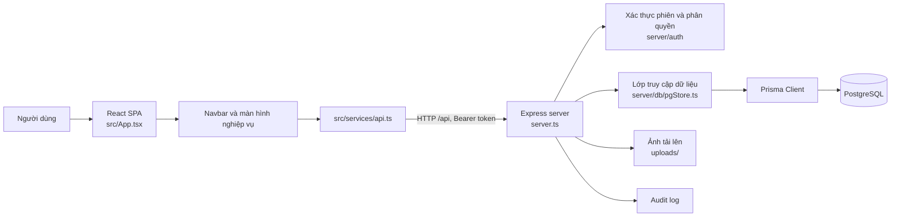

# Kiến trúc hiện tại của Aura Talent Management

> Tài liệu này mô tả kiến trúc thể hiện trong mã nguồn repository. Đây là phân tích tĩnh; không xác nhận trạng thái triển khai production hoặc kết nối cơ sở dữ liệu thực tế.

## Tổng quan

Aura Talent Management được tổ chức thành ứng dụng web client–server trong cùng repository. Frontend là SPA viết bằng React và TypeScript; backend là API Express chạy trên Node.js; dữ liệu chính được lưu trong PostgreSQL thông qua Prisma ORM.

## Cấu trúc repository

```text
.
├── docs/                         # Tài liệu dự án
│   ├── api/                      # Hợp đồng API
│   ├── architecture/             # Tổng quan hệ thống, sơ đồ module
│   ├── changes/                  # Change records và changelog
│   ├── database/                 # Schema, quan hệ, data dictionary
│   └── security/                 # Xác thực, phân quyền, JWT
├── prisma/
│   ├── client/                   # Prisma Client được sinh
│   ├── migrations/               # Baseline và migrations hiện hành
│   ├── migrations-archive/       # Migrations lưu trữ
│   └── schema.prisma             # Mô hình dữ liệu
├── public/                       # Tài nguyên tĩnh frontend
├── scripts/                      # Migration, seed, preflight và vận hành
│   ├── migrate-json-to-pg.ts      # Công cụ chuyển dữ liệu JSON sang PostgreSQL
│   ├── migrate-admin-account.ts  # Migration tài khoản quản trị
│   └── preflight-production.ts   # Kiểm tra trước triển khai
├── server/
│   ├── auth/
│   │   ├── authorization.ts      # Chính sách quyền
│   │   ├── jwt.ts                # Access/refresh token
│   │   ├── password.ts           # Mật khẩu
│   │   └── session.ts            # Phiên đăng nhập
│   ├── data/
│   │   ├── defaultData.ts        # Dữ liệu mặc định
│   │   └── store.ts              # Store dữ liệu
│   └── db/
│       ├── pgStore.ts            # Truy cập PostgreSQL và nghiệp vụ dữ liệu
│       └── prisma.ts             # Khởi tạo Prisma Client
├── src/
│   ├── components/               # Component dùng lại
│   │   ├── IdolModal.tsx         # Tạo/sửa hồ sơ
│   │   ├── Navbar.tsx            # Điều hướng và menu phân hệ
│   │   └── WorkAssignmentModal.tsx # Giao công tác
│   ├── services/
│   │   └── api.ts                # API client và quản lý access token
│   ├── types/
│   │   ├── index.ts              # Kiểu dữ liệu nghiệp vụ
│   │   └── roles.ts              # Kiểu vai trò/quyền
│   ├── utils/                    # Quy tắc tính toán và tiện ích dùng chung
│   ├── views/                    # Màn hình theo phân hệ
│   │   ├── AdminPortalView.tsx   # Quản trị
│   │   ├── FinanceManagementView.tsx # Tài chính
│   │   ├── IdolListView.tsx      # Danh sách nhân sự/Idol
│   │   ├── PayrollManagementView.tsx # Payroll
│   │   ├── TaskManagementView.tsx # Nhiệm vụ
│   │   └── WorkScheduleView.tsx  # Lịch làm việc
│   ├── App.tsx                   # Điều phối SPA và phân hệ
│   └── main.tsx                  # Entry point frontend
├── test/                         # Kiểm thử tự động, ví dụ authorization.test.ts
├── uploads/                      # Tệp tải lên, ví dụ ảnh hồ sơ
├── server.ts                     # Điểm khởi chạy và đăng ký API Express
├── index.html                    # HTML entry cho Vite
├── package.json                  # Scripts và dependencies
└── vite.config.ts                # Cấu hình Vite
```

Danh sách file bên dưới một số thư mục là ví dụ tiêu biểu, không phải inventory đầy đủ. Các thư mục `dist/`, `node_modules/`, `.pnpm-store/`, `backups/` và `reports/` cũng có trong repository làm việc hiện tại; chúng là đầu ra build, dependency, dữ liệu lưu trữ hoặc báo cáo, không phải các lớp runtime cốt lõi trong sơ đồ trên.



## Frontend

- [`src/App.tsx`](../src/App.tsx) quản lý phiên người dùng, phân hệ đang mở, tải dữ liệu và điều kiện hiển thị theo quyền. Các màn hình nghiệp vụ được tải lazy.
- [`src/views/`](../src/views/) chứa các màn hình theo phân hệ: hồ sơ, dashboard, lịch, nhiệm vụ, KPI, payroll, tài chính và quản trị.
- [`src/components/`](../src/components/) chứa các thành phần dùng lại như điều hướng, modal hồ sơ, bộ chọn, phân quyền và giao việc.
- [`src/services/api.ts`](../src/services/api.ts) gom các lời gọi HTTP, thêm access token, refresh phiên khi gặp 401 và xử lý phiên hết hạn.
- [`src/types/`](../src/types/) định nghĩa kiểu dữ liệu phía frontend; [`src/utils/`](../src/utils/) chứa các hàm tính toán, định dạng và quy tắc dùng chung.

Frontend ẩn hoặc điều hướng khỏi các màn hình không được cấp quyền để phù hợp trải nghiệm người dùng. Đây không phải ranh giới bảo mật cuối cùng; backend vẫn phải thực thi quyền cho API.

## Backend và luồng API

- [`server.ts`](../server.ts) khởi tạo Express, cấu hình middleware, đăng ký endpoint `/api`, phục vụ tệp tĩnh và khởi động server.
- Các API được nhóm theo tài nguyên nghiệp vụ như hồ sơ Idol/nhân sự, lịch, nhiệm vụ, giao công tác, nghỉ phép, chấm điểm, payroll, doanh thu và chi phí.
- Một request có xác thực đi qua middleware kiểm tra access token, tải tài khoản, kiểm tra chính sách route/action, sau đó đến handler và lớp lưu trữ.
- Đăng nhập, refresh token, quản lý phiên và mật khẩu có các module trong [`server/auth/`](../server/auth/). Chính sách vai trò và quyền route nằm trong `server/auth/authorization.ts`.
- Các mutation API được ghi nhận bằng request ID và audit log theo cấu hình server hiện tại.
- Tệp ảnh được nhận qua endpoint upload, lưu dưới `uploads/` và phục vụ qua static route.

## Lớp dữ liệu

- [`prisma/schema.prisma`](../prisma/schema.prisma) là định nghĩa schema Prisma; các thay đổi schema được biểu diễn bằng migration trong [`prisma/migrations/`](../prisma/migrations/).
- [`server/db/prisma.ts`](../server/db/prisma.ts) khởi tạo Prisma Client.
- [`server/db/pgStore.ts`](../server/db/pgStore.ts) là lớp truy cập PostgreSQL và chứa các thao tác dữ liệu/nghiệp vụ cho nhiều phân hệ.
- Schema dùng chung bao gồm tài khoản/role/session, personnel, lịch và nhiệm vụ, giao việc, nghỉ phép/phê duyệt, payroll, KPI/chấm điểm, doanh thu/chi phí, lịch sử sử dụng dịch vụ và audit log.
- [`server/data/`](../server/data/) chứa store hoặc dữ liệu cấu hình/seed dùng trong các luồng phù hợp; dữ liệu này không mặc nhiên đại diện cho production.

## Ranh giới nghiệp vụ

Các nhóm chức năng hiện diện trong cùng ứng dụng và backend, không phải các dịch vụ triển khai độc lập:

1. Hồ sơ nhân sự, Idol và tài khoản.
2. Dashboard theo vai trò.
3. Lịch làm việc, ca live, nhiệm vụ và giao công tác.
4. Nghỉ phép, yêu cầu và thông báo.
5. KPI, chấm điểm và xếp hạng.
6. Payroll và phản ánh bảng lương.
7. Doanh thu, chi phí và báo cáo tài chính.
8. Quản trị hệ thống, đơn vị và phân quyền.

Quy tắc nghiệp vụ có thể được chia giữa giao diện, tiện ích frontend, route handler và store backend. Với nghiệp vụ nhạy cảm như quyền, lương, chấm điểm, phạt và phê duyệt, cần xác nhận điều kiện tại server thay vì tin vào trạng thái do client gửi lên.

## Nhận xét kiến trúc

### Đặc điểm đã xác nhận từ cấu trúc mã

- Frontend được phân chia theo màn hình nghiệp vụ và có lớp API client dùng chung.
- Backend có các module riêng cho xác thực, phân quyền và kết nối cơ sở dữ liệu.
- PostgreSQL và Prisma là trục dữ liệu chính; schema được quản lý bằng migration.
- Tổ chức hiện tại là ứng dụng tập trung theo module trong một codebase, với một backend API và một schema dữ liệu chung.

### Điểm tập trung cần lưu ý

Đăng ký route và nhiều middleware tập trung trong `server.ts`; nhiều thao tác lưu trữ và nghiệp vụ tập trung trong `pgStore.ts`. Cấu trúc này giúp theo dõi luồng từ API tới dữ liệu trong một nơi, nhưng làm tăng kích thước các module trung tâm khi phân hệ tiếp tục phát triển. Đây là nhận xét về tổ chức mã, không phải kết luận rằng hệ thống đang gặp vấn đề hiệu năng.

## Giới hạn xác minh

Tài liệu được lập từ mã nguồn, schema và tài liệu repository. Chưa chạy ứng dụng, kiểm tra trình duyệt, xác minh kết nối PostgreSQL hoặc kiểm tra môi trường production trong quá trình lập tài liệu này. Chi tiết nghiệp vụ và trạng thái triển khai được mô tả riêng trong [`docs/system-capabilities.md`](./system-capabilities.md); trạng thái và quyết định gần đây nằm trong [`docs/project-state.md`](./project-state.md).
