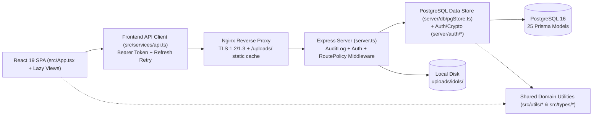

# Aura Talent Management — System & Functional Specification Document

> **Note**: Static codebase analysis based strictly on repository source files as of `2026-11-11`. Includes observed architecture, Prisma data model, REST API surface, shared domain rules, security/RBAC policies, and technical observations.

---

## 1. Project Overview & Architecture

### 1.1 Core Purpose
**Aura Talent Management** is an internal Talent Agency & Corporate Operations ERP designed for managing live-streaming/entertainment talents (**Idols**) alongside corporate staff across three core business domains:
1. **Talent & HR Lifecycle Management**: Unified roster for Idol teams and corporate departments (`Quản lý & Phát triển Idol`, `Vận hành Livestream`, `Nội dung & Sản xuất`, `Kinh doanh & Booking`, `Marketing`, `HR & Kế Toán`, `Ban Giám đốc`), dynamic custom personnel columns, onboarding/offboarding approval workflows, salary history tracking, and annual/sick/personal leave management.
2. **Operations, Scheduling & Performance**: Weekly shift scheduling (`WorkSchedule`), Kanban/task time-tracking (`PersonnelTask`), ad-hoc work assignment dispatch with acceptance deadlines, compensation/rest-day grants, violation penalties, and director-delegated waiver workflows (`WorkAssignment`), plus dual evaluation systems (subjective scoring sheets/leaderboards via `Criterion`/`ScoreRecord` and quantitative operational KPIs via `KpiSetting`/`OperationalMetric`).
3. **Financial Accounting, Payroll & Reconciliation**: Multi-segment prorated monthly payroll generation (`PayrollPeriod`/`PayrollRecord`) integrating overtime, KPI bonuses, revenue commissions, work-assignment adjustments, insurance/PIT deductions, and employee payslip disputes (`PayrollDispute`); commercial deal tracking (`RevenueTransaction`), external client service bookings & installment payments (`ServiceUsageRecord`/`ServiceUsagePayment`), corporate OpEx/CapEx ledger (`CompanyExpense`), and multi-period Profit & Loss (`FinancePnLSummary`) analytics.

### 1.2 Tech Stack Breakdown

| Layer | Technology / Library | Version / Details | Source |
| :--- | :--- | :--- | :--- |
| **Runtime & Language** | Node.js + TypeScript (ESM) | Node 22 Alpine in Docker; `"type": "module"`, `tsx ^4.21.0`, `pnpm@10.33.0` | [package.json](../../package.json#L1-L62), [Dockerfile](../../Dockerfile#L1-L79) |
| **Backend Framework** | Express.js | `express ^4.21.2` | [package.json](../../package.json#L18), [server.ts](../../server.ts#L1-L1956) |
| **Database & ORM** | PostgreSQL + Prisma ORM | PostgreSQL 16 (`postgres:16-alpine`), `prisma 6.19.3`, `@prisma/client ^6.19.3` (generated to `prisma/client`) | [schema.prisma](../../prisma/schema.prisma#L1-L12), [docker-compose.yml](../../docker-compose.yml#L2) |
| **Frontend Framework** | React + Vite + Tailwind CSS | `react ^19.0.1`, `react-dom ^19.0.1`, `vite ^8.3.0`, `@tailwindcss/vite ^4.3.3` | [package.json](../../package.json#L20-L37), [vite.config.ts](../../vite.config.ts#L1-L42) |
| **UI & Animation** | Lucide React + Motion | `lucide-react ^0.546.0`, `motion ^12.23.24` | [package.json](../../package.json#L19-L21) |
| **File Upload** | Multer | `multer ^2.5.0` (disk storage under `uploads/idols/`, max 5 MB) | [package.json](../../package.json#L22), [server.ts](../../server.ts#L139-L214) |
| **Auth & Crypto** | Native `node:crypto` | Hand-rolled HS256 JWT (`createHmac`), `scrypt` (`N=16384, r=8, p=1`), 48-byte base64url refresh tokens | [jwt.ts](../../server/auth/jwt.ts#L1-L99), [password.ts](../../server/auth/password.ts#L1-L40) |
| **Infrastructure & CI/CD** | Docker, Nginx, GitLab CI | Multi-stage Dockerfile, Nginx TLS reverse proxy, 3-stage GitLab CI (`verify`, `deploy_staging`, `deploy_production`) | [docker-compose.yml](../../docker-compose.yml#L1-L94), [nginx.conf](../../nginx/nginx.conf#L1-L104), [.gitlab-ci.yml](../../.gitlab-ci.yml#L1-L132) |
| **Testing** | Node native test runner | `node --test test/**/*.test.ts` with `tsx` | [package.json](../../package.json#L13) |

### 1.3 Architectural Pattern & Directory Layout
The application is implemented as a **Modular Monolith (Single-Process Full-Stack TypeScript Application)** backed by a **Transactional Data Access Layer (`pgStore`)**:
- **Single Runtime Entry Point**: [`server.ts`](../../server.ts) hosts both the `/api/*` REST API and the frontend (serving Vite in middleware mode during development, or `dist/` static SPA assets in production).
- **Direct Route-to-Store Layering**: API endpoints in [`server.ts`](../../server.ts) invoke authentication/authorization middleware and delegate directly to domain methods on the singleton [`dbStore`](../../server/db/pgStore.ts) backed by Prisma transactions. Shared pure domain calculation helpers under `src/utils/` (e.g., payroll deductions, salary proration, work assignment policies, leave quota, timezone clock) are imported symmetrically by both frontend views and backend `pgStore.ts`.
- **Frontend State Pattern**: React state is centralized in [`App.tsx`](../../src/App.tsx) (tab-scoped lazy data fetching cached via `loadedDataRef`, global simulated reference clock, session restoration) combined with localized view-level fetches for heavy accounting tabs (`PayrollManagementView`, `FinanceManagementView`, `RevenueManagementView`, `ServiceUsageHistoryView`).

**Directory Layout**:
- [`server.ts`](../../server.ts): Express server bootstrap, Multer upload handler, auth/audit middleware, all REST route definitions, and SPA/Vite handler.
- [`server/auth/`](../../server/auth): [`jwt.ts`](../../server/auth/jwt.ts), [`password.ts`](../../server/auth/password.ts), [`session.ts`](../../server/auth/session.ts), [`authorization.ts`](../../server/auth/authorization.ts).
- [`server/db/`](../../server/db): [`prisma.ts`](../../server/db/prisma.ts) (singleton client) and [`pgStore.ts`](../../server/db/pgStore.ts) (5,768-line domain & persistence engine).
- `server/data/` (`store.ts`, `defaultData.ts`): **Legacy unreferenced JSON file-store** superseded by `pgStore.ts` (zero active imports anywhere in the codebase).
- [`prisma/`](../../prisma): [`schema.prisma`](../../prisma/schema.prisma) and squashed baseline migration [`migration.sql`](../../prisma/migrations/00000000000000_squashed_baseline/migration.sql).
- [`src/`](../../src): [`App.tsx`](../../src/App.tsx), [`services/api.ts`](../../src/services/api.ts), `types/` (`index.ts`, `roles.ts`), `utils/` (business rules & calculators), `views/` (16 lazy-loaded screens), `components/` (Navbar & 21 shared modals/inputs).
- [`scripts/`](../../scripts): Production preflight, bootstrap admin seed, RBAC role migration, environment guards, finance/salary audit helpers.
- [`test/`](../../test): 33 unit test files covering authorization, JWT/scrypt, payroll math, leave allocation, KPI targets, work-assignment policies, and DB constraints.

---

## 2. Data Model & Storage

### 2.1 Key Entities & Relationships (25 Prisma Models)
All entities reside in [`prisma/schema.prisma`](../../prisma/schema.prisma).

#### A. Identity, RBAC & Personnel
| Model (`@@map`) | Primary Key / Uniques | Key Fields | Relationships |
| :--- | :--- | :--- | :--- |
| **`UserAccount`** (`users`) | `id` (Int auto); `@unique` `username`, `email` | `password` (`scrypt-v1`), `name`, `role`, `roleTitle`, `department`, `accountType` (`standard`\|`system_admin`), `isSuperAdmin`, `isBusinessAdmin`, `idolId`, legacy JSON `allowedTabs`/`allowedActions`/`allowedDepartments` | **1-N** `UserRole`, **1-N** `AuthSession`, **1-1** optional `Personnel` (via `Personnel.userId`), **1-N** `WorkAssignment` (creator), **1-N** `ApprovalRequest` (`requesterId`/`reviewerId`), **1-N** `LeaveRequest` (`reviewerId`), **1-N** `AuditLog` (`actorUserId`) |
| **`Role`** (`roles`) | `id` (Int); `@unique` `code` | `name`, `roleTitle`, `department`, `category` (`system`\|`corporate`\|`idol`), `isSystemRole`, `defaultTabs` (Json), `defaultActions` (Json), `defaultDepartments` (Json) | **N-N** `UserAccount` via `UserRole` |
| **`UserRole`** (`user_roles`) | Composite PK `[userId, roleId]` | `userId`, `roleId`, `assignedAt`, `assignedById` | Join table linking `UserAccount` and `Role` (cascade delete) |
| **`AuthSession`** (`auth_sessions`) | `id` (String UUID); `@unique` `refreshTokenHash` | `userId`, `expiresAt`, `revokedAt`, `userAgent`, `ipAddress` | **N-1** `UserAccount` (cascade delete) |
| **`Personnel`** (`personnel`) | `id` (Int auto); `@unique` `userId` | `realName`, `stageName`, `department`, `personnelType`, `status`, `cooperationType`, `assignedRole`, `isIdol`, `baseSalary`, `allowance`, `kpiBonus`, `hourlyRate`, `kpiTarget`, `liveHoursTarget`, `salesTarget`, `engagementTarget`, `giftsTarget`, `customFields` (Json), `bankInfo` (Json), `idolProfile` (Json), `joinDate`, `resignedDate` | **1-1** optional `UserAccount`; **1-N** `PersonnelActivity`, `WorkSchedule`, `PersonnelTask`, `WorkAssignmentAssignee`, `LeaveRequest`, `PayrollRecord`, `PayrollDispute`, `PersonnelSalaryHistory`, `KpiGroupMember`, `OperationalMetric`, `ScoreRecord`, `RevenueTransaction`, `ServiceUsageRecord`, `ApprovalRequest` |
| **`PersonnelActivityType`** (`personnel_activity_types`) | `id` (Int); `@unique` `code` | `name`, `category` (`idol_activity`\|`staff_activity`), `defaultUnit`, `isActive`, `displayOrder` | **1-N** `PersonnelActivity`, `WorkSchedule`, `PersonnelTask`, `KpiSetting` |
| **`PersonnelActivity`** (`personnel_activities`) | `id` (Int); `@unique` `[personnelId, activityTypeId]` | `isPrimary`, `customTarget` (Json) | Join table linking `Personnel` and `PersonnelActivityType` |
| **`PersonnelColumn`** (`personnel_columns`) | `id` (Int); `@unique` `key` | `label`, `type` (`text`\|`number`\|`date`\|`boolean`\|`select`\|`textarea`), `sensitivity` (`public`\|`internal`\|`sensitive`), `isRequired`, `isActive`, `isSystem`, `sortOrder`, `options` (Json) | Defines dynamic schema rendered into `Personnel.customFields` |

#### B. Schedules, Tasks, Work Assignments & Leave
| Model (`@@map`) | Primary Key / Uniques | Key Fields | Relationships |
| :--- | :--- | :--- | :--- |
| **`WorkSchedule`** (`work_schedules`) | `id` (String) | `personnelId`, `activityTypeId`, `dayOfWeek` (`0-6`), `startTime`, `endTime`, `title`, `platform`, `location`, `type` (`livestream`\|`meeting`\|`training`\|`event`\|`other`) | **N-1** `Personnel` (cascade), **N-1** optional `PersonnelActivityType` (set null) |
| **`PersonnelTask`** (`personnel_tasks`) | `id` (String) | `personnelId`, `activityTypeId`, `title`, `status` (`todo`\|`in_progress`\|`completed`), `priority`, `dueDate`, `subtasks` (Json array), `timerStartedAt`, `timerStoppedAt`, `loggedDurationMinutes`, `category` | **N-1** `Personnel` (cascade), **N-1** optional `PersonnelActivityType` (set null) |
| **`WorkAssignment`** (`work_assignments`) | `id` (String) | `title`, `startAt`, `endAt`, `location`, `assignmentType` (`optional`\|`mandatory`), `acceptanceDeadline`, `status` (`pending`\|`active`\|`completed`\|`cancelled`), `createdById`, `cancelledById`, `cancelReason`, `compensationBonusRate` (default `1.5`), `compensationHours`, `compensatedRestDate`, `hasWork` | **N-1** `UserAccount` (`createdById`), **1-N** `WorkAssignmentAssignee` |
| **`WorkAssignmentAssignee`** (`work_assignment_assignees`) | `id` (String); `@unique` `[assignmentId, personnelId]` | `responseStatus` (`pending`\|`accepted`\|`declined`\|`overdue`\|`completed`\|`cancelled`), `violationStatus` (`none`\|`under_review`\|`confirmed`\|`waived`), `violationPenaltyAmount`, `waiverRequestStatus`, `waiverReviewStatus`, `waiverPenaltyRate` | **N-1** `WorkAssignment` (cascade), **N-1** `Personnel` (cascade) |
| **`WorkAssignmentApprovalDelegation`** (`work_assignment_approval_delegations`) | `id` (String) | `directorId`, `delegateId`, `startsAt`, `endsAt`, `revokedAt`, `note` | **N-1** `UserAccount` (director, delegate, revoker) |
| **`LeaveRequest`** (`leave_requests`) | `id` (String) | `personnelId`, `leaveType` (`annual`\|`sick`\|`personal`), `startDate`, `endDate`, `totalDays`, `annualLeaveDays`, `unpaidLeaveDays`, `reason`, `status` (`pending`\|`approved`\|`rejected`), `reviewedById` | **N-1** `Personnel` (cascade), **N-1** optional `UserAccount` |
| **`ApprovalRequest`** (`approval_requests`) | `id` (String) | `actionType` (`create_idol`\|`update_idol`\|`delete_idol`), `targetPersonnelId`, `payload` (Json), `status` (`pending`\|`approved`\|`rejected`), `requesterId`, `reviewerId`, `rejectionReason` | **N-1** optional `Personnel` (set null), **N-1** `UserAccount` (requester & reviewer) |

#### C. Payroll, Salary History & Disputes
| Model (`@@map`) | Primary Key / Uniques | Key Fields | Relationships |
| :--- | :--- | :--- | :--- |
| **`PayrollPeriod`** (`payroll_periods`) | `id` (`"payroll-YYYY-MM"`); `@unique` `period` (`"YYYY-MM"`) | `title`, `status` (`Draft`\|`Pending`\|`Approved`\|`Locked`), `totalGross`, `totalDeductions`, `totalNet`, `employeeCount`, `submittedById`, `approvedById` | **1-N** `PayrollRecord`, **1-N** `PayrollDispute` |
| **`PayrollRecord`** (`payroll_records`) | `id` (String); `@unique` `[periodId, personnelId]` | `period`, `employeeName`, `personnelType`, `baseSalary`, `workDays`, `standardWorkDays`, `overtimeHours`, `overtimePay`, `kpiScore`, `kpiBonus`, `commissionGmv`, `giftShare`, `allowance`, `hotBonus`, `otherBonus`, `workAssignmentPay`, `workAssignmentPenalty`, `socialInsurance`, `companyInsurance`, `personalIncomeTax`, `otherDeduction`, `grossSalary`, `totalDeductions`, `netSalary`, `earningsDetail` (Json), `deductionsDetail` (Json), `bankInfo` (Json), `salarySegments` (Json) | **N-1** `PayrollPeriod` (cascade), **N-1** `Personnel` (cascade), **1-N** `PayrollDispute` |
| **`PayrollDispute`** (`payroll_disputes`) | `id` (String) | `periodId`, `recordId`, `personnelId`, `submittedById`, `category` (`base_salary`\|`work_days`\|`overtime`\|`kpi_bonus`\|`commission`\|`allowance`\|`deduction`\|`other`), `reason`, `expectedAmount`, `status` (`open`\|`reviewing`\|`resolved`\|`rejected`), `resolutionNote`, `resolvedById` | **N-1** `PayrollPeriod`, `PayrollRecord`, `Personnel` (cascade), **N-1** `UserAccount` (submitter, resolver) |
| **`PersonnelSalaryHistory`** (`personnel_salary_history`) | `id` (String); `@unique` `[personnelId, effectiveFrom]` | `effectiveFrom` (`YYYY-MM-DD`), `baseSalary`, `allowance`, `kpiBonus`, `hourlyRate`, `note`, `createdById` | **N-1** `Personnel` (cascade), **N-1** optional `UserAccount` |

#### D. KPI & Evaluation Scoring
| Model (`@@map`) | Primary Key / Uniques | Key Fields | Relationships |
| :--- | :--- | :--- | :--- |
| **`KpiGroup`** (`kpi_groups`) | `id` (String) | `name`, `type` (`system`\|`custom`), `category` (`idol`\|`corporate`\|`mixed`), `department`, `leaderId` | **N-N** `Personnel` via `KpiGroupMember` (PK `[groupId, personnelId]`), **1-N** `KpiSetting` |
| **`KpiSetting`** (`kpi_settings`) | `id` (String) | `code`, `name`, `unit`, `scopeType` (`group`\|`individual`), `groupId`, `assignedIdolId`, `activityTypeId`, `period` (`monthly`\|`quarterly`\|`yearly`), `targetValue`, `minThreshold`, `weight`, `bonusIncentive` (Json), `status` (`active`\|`inactive`) | **N-1** optional `KpiGroup` (set null), optional `Personnel` (cascade), optional `PersonnelActivityType` |
| **`OperationalMetric`** (`operational_metrics`) | `id` (String); `@unique` `[personnelId, period, metricCode]` | `metricCode`, `actualValue`, `source`, `note` | **N-1** `Personnel` (cascade) |
| **`Criterion`** (`criteria`) | `id` (String); `@unique` `code` | `name`, `maxScore`, `weight`, `priorityOrder` | **1-N** `ScoreRecordItem` |
| **`ScoreRecord`** (`score_records`) | `id` (String); `@unique` `[personnelId, period]` | `period`, `comment` | **N-1** `Personnel` (cascade), **1-N** `ScoreRecordItem` |
| **`ScoreRecordItem`** (`score_record_items`) | `id` (String); `@unique` `[scoreRecordId, criterionId]` | `score` (Float) | Join table linking `ScoreRecord` & `Criterion` (cascade) |

#### E. Commercial Revenue, Service Usage, Expenses, Settings & Audit
| Model (`@@map`) | Primary Key / Uniques | Key Fields | Relationships |
| :--- | :--- | :--- | :--- |
| **`RevenueCategory`** (`revenue_categories`) | `id` (Int); `@unique` `code` | `name`, `defaultIdolShareRate`, `isActive`, `displayOrder` | **1-N** `RevenueTransaction` |
| **`RevenuePlatform`** (`revenue_platforms`) | `id` (Int); `@unique` `code` | `name`, `defaultFeeRate`, `feeType` (`percentage`\|`fixed`), `isActive` | **1-N** `RevenueTransaction` |
| **`RevenueTransaction`** (`revenue_transactions`) | `id` (String); `@unique` `transactionCode` | `personnelId`, `period`, `transactionDate`, `categoryId`, `platformId`, `title`, `payoutMode` (`percentage`\|`fixed`\|`hybrid`), `grossAmount`, `totalDeductions`, `netAmount`, `idolShareRate`, `fixedPayoutAmount`, `idolPayoutAmount`, `companyProfitAmount`, `status` (`draft`\|`verified`\|`synced_to_payroll`\|`cancelled`), `syncedAt` | **N-1** `Personnel`, `RevenueCategory`, `RevenuePlatform`; **N-1** optional `UserAccount` (creator/approver); **1-N** `RevenueDeductionItem`, **1-N** `ServiceUsageRecord` |
| **`RevenueDeductionItem`** (`revenue_deduction_items`) | `id` (String) | `name`, `deductionType` (`platform_fee`\|`production_cost`\|`tax`\|`other`), `amount`, `proofUrl` | **N-1** `RevenueTransaction` (cascade) |
| **`ServiceUsageRecord`** (`service_usage_records`) | `id` (String); `@unique` `usageCode` | `personnelId`, `serviceName`, `usageDate`, `startAt`, `endAt`, `quantity`, `grossAmount`, `discountAmount`, `netAmount`, `status` (`planned`\|`in_progress`\|`completed`\|`cancelled`), `paymentStatus` (`unpaid`\|`partially_paid`\|`paid`), `paidAmount`, `outstandingAmount`, `assignedUserId`, `revenueTransactionId` | **N-1** `Personnel` (restrict delete!), optional `UserAccount`, optional `RevenueTransaction` (set null); **N-N** `UserAccount` via `ServiceUsageAssignee`; **1-N** `ServiceUsagePayment` |
| **`ServiceUsagePayment`** (`service_usage_payments`) | `id` (String) | `amount`, `paidAt`, `paidById`, `reference`, `note` | **N-1** `ServiceUsageRecord` (cascade), optional `UserAccount` |
| **`CompanyExpense`** (`company_expenses`) | `id` (String); `@unique` `expenseCode` | `period`, `expenseDate`, `category` (`LABOR_INSURANCE`\|`FACILITY`\|`INVESTMENT_CAPEX`\|`OPERATIONS_OPEX`\|`DYNAMIC_EVENT`\|`OTHER`), `amount`, `facilityType` (`fixed`\|`rented`), `paymentMethod`, `status` (`pending`\|`approved`\|`paid`\|`cancelled`) | **N-1** optional `UserAccount` |
| **`AppSetting`** (`app_settings`) | `id` (`"global_settings"`) | `brandName`, `scoreCalculationMode`, `referenceYear`, `referenceDate`, `referenceTime`, `referenceClockAnchorAt`, `workdayStartTime`, `workdayEndTime`, `departmentParentMap` (Json — also embeds `columnHeaders`), `leaderboardRules` (Json) | Singleton row |
| **`SystemLookup`** (`system_lookups`) | `id` (Int); `@unique` `[type, value]` | `type` (`department`\|`status`\|`personnel_type`), `value`, `orderIndex` | Key-value lookup table |
| **`AuditLog`** (`audit_logs`) | `id` (String); `@unique` `requestId` | `actorUserId`, `actorUsername`, `action`, `resource`, `resourceId`, `statusCode`, `method`, `path`, `ipAddress`, `userAgent`, `metadata` (Json) | **N-1** optional `UserAccount` |

### 2.2 Database Migrations, Indexing & Caching
- **Migrations**: Managed via Prisma Migrate (`prisma migrate deploy` on container startup via [`docker-entrypoint.sh`](../../docker-entrypoint.sh#L1-L15)). History was consolidated into a single baseline migration: [`00000000000000_squashed_baseline/migration.sql`](../../prisma/migrations/00000000000000_squashed_baseline/migration.sql).
- **Indexing Strategy**: The baseline SQL defines **74 indexes** (unique constraints + composite B-tree query indexes) tailored for primary filters:
  - Auth lookups: `users_username_key`, `users_email_key`, `auth_sessions_refreshTokenHash_key`, `(userId, revokedAt)`, `expiresAt`.
  - Operational queries: `personnel(isIdol, personnelType, status)`, `work_schedules(personnelId, dayOfWeek)`, `work_assignments(status, acceptanceDeadline)`, `work_assignment_approval_delegations(delegateId, startsAt, endsAt, revokedAt)`.
  - Financial & Payroll: `payroll_records(personnelId, period)`, `payroll_disputes(periodId, status)`, `revenue_transactions(period, status)`, `company_expenses(period, category)` / `(period, status)`, `service_usage_records(assignedUserId, startAt, endAt, status)`.
  - Audit queries: `(actorUserId, createdAt)`, `(resource, resourceId, createdAt)`, `(action, createdAt)`.
- **Caching Layers**:
  - **Backend**: No Redis or persistent server-side cache exists. Every query hits PostgreSQL directly; `pgStore.ts` builds short-lived per-request `Map` lookups during payroll sync and aggregation.
  - **Frontend**: [`App.tsx`](../../src/App.tsx#L305-L375) tracks loaded datasets in `loadedDataRef` (`Set<string>`) to avoid refetching common collections (`idols`, `criteria`, `scores`, `tasks`, etc.) across tab switches until mutation or logout/login (`loadedDataRef.current.clear()`).
  - **Edge/CDN**: [`nginx.conf`](../../nginx/nginx.conf#L85-L88) serves `/uploads/` directly from the shared Docker volume with `expires 30d; add_header Cache-Control "public, immutable";`.

---

## 3. Detailed Functional Modules

### 3.1 Authentication, Session & Profile Management
- **Module Purpose**: Verifies credentials (`scrypt-v1`), issues short-lived HS256 JWT access tokens paired with database-backed rotating refresh tokens stored in an `HttpOnly` cookie, and permits users to update personal profile/password details.
- **Entry Points / Endpoints** ([`server.ts`](../../server.ts#L966-L1065)):
  - `POST /api/auth/login`
  - `POST /api/auth/refresh`
  - `POST /api/auth/logout`
  - `GET /api/auth/me`
  - `PUT /api/auth/profile`
- **Input & Validation**:
  - `login`: `{ username, password }`. Both trimmed/checked for non-empty (`401` on invalid credentials).
  - `refresh`: Reads `aura_refresh_token` cookie (requires cookie presence -> `401` if absent or revoked/expired).
  - `profile`: `{ userId?, name?, realName?, stageName?, dob?, hometown?, height?, weight?, phone?, address?, avatarUrl?, currentPassword?, newPassword? }`. If `newPassword` is provided without `currentPassword`, or `currentPassword` fails verification -> `400`.
- **Business Logic & Internal Flow**:
  1. `login` delegates to [`pgStore.authenticateUser`](../../server/db/pgStore.ts#L2440-L2466): compares `scrypt` hashes via `timingSafeEqual`; if a legacy plaintext password matches (`!isPasswordHash`), transparently upgrades the stored password to `scrypt-v1` on login.
  2. Resolves effective permissions via [`mapDbUser`](../../server/db/pgStore.ts#L625-L695) (merging `UserRole -> Role` permissions or falling back to legacy JSON columns, and enforcing `system_admin` full rights).
  3. Creates an [`AuthSession`](../../server/auth/session.ts) row storing `HMAC-SHA256` hash of a 48-byte random token, sets `aura_refresh_token` cookie (`Path=/api/auth; HttpOnly; SameSite=Lax`, plus `Secure` when JWT enforcement is active), and returns `{ success: true, user, accessToken }`.
  4. `refresh` hashes the cookie token, looks up active non-revoked/non-expired session, verifies user still exists, rotates the refresh token hash + extends `expiresAt`, sets new cookie, and returns fresh `accessToken` + `user`.
  5. `logout` revokes the session row by `refreshTokenHash` and clears the cookie (`Max-Age=0`).
  6. `PUT /api/auth/profile` updates `UserAccount` and syncs overlapping fields (`realName`, `stageName`, `dob`, `hometown`, `height`, `weight`, `phone`, `currentLiving`, `avatarUrl`) onto linked `Personnel` if `user.idolId` exists.
- **Output & Response**: `{ success: boolean, user: UserAccount, accessToken?: string }`; `GET /api/auth/me` returns `{ user: UserAccount | null }`.
- **Security / Access Control**: Public endpoints: `/auth/login`, `/auth/refresh`, `/auth/logout`. `GET /api/auth/me` requires authenticated token when `AUTH_REQUIRE_JWT=true` or `NODE_ENV=production` (`401` otherwise). *(Updated 2026-11-11)*: `PUT /api/auth/profile` enforces an authenticated caller (`401`), rejects mismatches when `req.body.userId` differs from `requestUser.id` (`403`), and writes only to `requestUser.id`.

---

### 3.2 RBAC, User Accounts, Approvals & System Governance
- **Module Purpose**: Manages user accounts, role assignments, organizational lookups (`departments`, `statuses`, `personnel-types`), global settings, dynamic personnel column definitions, and the lower-privilege Idol CRUD approval queue (`AdminPortalView`).
- **Entry Points / Endpoints** ([`server.ts`](../../server.ts#L673-L965,L1067-L1285)):
  - Users: `GET /api/users`, `POST /api/users`, `PUT /api/users/:id`, `DELETE /api/users/:id`, `POST /api/users/sync-idols`
  - Approvals: `GET /api/approvals`, `POST /api/approvals`, `POST /api/approvals/:id/approve`, `POST /api/approvals/:id/reject`, `DELETE /api/approvals/:id`
  - Lookups & Settings: `GET/POST/PUT/DELETE /api/departments`, `/api/statuses`, `/api/personnel-types`; `GET/PUT /api/settings`; `GET/PUT /api/column-headers`; `POST /api/reset`
  - Dynamic Columns: `GET /api/personnel-columns`, `POST /api/personnel-columns`, `PUT /api/personnel-columns/reorder`, `PUT /api/personnel-columns/:id`, `DELETE /api/personnel-columns/:id`, `POST /api/personnel-columns/:id/restore`
- **Input & Validation**:
  - `POST/PUT /api/users`: checks uniqueness of `username`/`email`; hashes password via `hashPassword` if supplied (non-production defaults initial password to `'123'`, whereas production throws unless provided via [`resolveInitialPassword`](../../server/db/pgStore.ts#L444-L450)). Enforces account invariants (`system_admin` vs `standard` cannot mix Idol linkage).
  - `POST /api/approvals`: `{ actionType, targetIdolId?, payload, requesterId, requesterName }`.
- **Business Logic & Internal Flow**:
  1. **Role Hydration**: [`mapDbUser`](../../server/db/pgStore.ts#L625-L695) pulls `userRoles[].role`; if any `Role` rows are attached, their `defaultTabs`, `defaultActions`, and `defaultDepartments` are unioned and **override** the legacy JSON columns on `UserAccount`.
  2. **Approvals**: Users without `manage_idols` permission submit `create_idol`, `update_idol`, or `delete_idol` requests from `App.tsx` (`handleOpenAddModal` / delete). On `POST /api/approvals/:id/approve` ([`pgStore.approveApproval`](../../server/db/pgStore.ts#L2761-L2829)), `'create_idol'` creates the `Personnel` record, `'update_idol'` applies `payload` mutations via `this.updateIdol` inside the transaction *(fixed 2026-11-11)*, and `'delete_idol'` deletes it (updating `ApprovalRequest.status = 'approved'`).
  3. **Lookups & Settings**: Stored in `SystemLookup` (`type` = `'department'` | `'status'` | `'personnel_type'`) and singleton `AppSetting` (`"global_settings"`). `columnHeaders` are persisted inside `AppSetting.departmentParentMap._columnHeaders`.
  4. **No-ops**: `POST /api/users/sync-idols` returns `{ synced: 0 }` ([`pgStore.syncIdolsWithUsers`](../../server/db/pgStore.ts#L2684)), and `POST /api/reset` is blocked in production (`403`) and executes an empty no-op in [`pgStore.reset`](../../server/db/pgStore.ts#L5225).
- **Output & Response**: Updated entities (`UserAccount`, `ApprovalRequest`, `AppSettings`, lookup arrays).
- **Security / Access Control** ([`authorization.ts`](../../server/auth/authorization.ts#L35-L75)):
  - `GET/POST/PUT/DELETE /api/users*`: `superAdminOnly: true` (`accountType === 'system_admin'`).
  - `GET /api/approvals`: requires one of `manage_approvals`, `manage_criteria`, `manage_settings` *(hardened 2026-11-11)*; `POST /api/approvals/:id/approve|reject`, `DELETE /api/approvals/:id`: `action: 'manage_approvals'`. (`POST /api/approvals` allows authenticated submissions).
  - `/api/departments*`: `manage_departments`; `/api/settings`, `/api/statuses*`, `/api/personnel-types*`, `/api/column-headers`, `/api/personnel-columns*`: `manage_settings`; `/api/reset`: `superAdminOnly: true`.

---

### 3.3 Personnel Roster, Salary History & File Uploads
- **Module Purpose**: Core CRUD for Idols and corporate employees (`Personnel`), multi-activity specialization tagging, immutable historical salary timeline (`PersonnelSalaryHistory`), field-level sensitivity masking, and deduplicated avatar/proof image storage.
- **Entry Points / Endpoints** ([`server.ts`](../../server.ts#L152-L302)):
  - `GET /api/idols`, `GET /api/idols/:id`, `POST /api/idols`, `PUT /api/idols/:id`, `DELETE /api/idols/:id`
  - `GET /api/idols/:id/salary-history`, `POST /api/idols/:id/salary-history`
  - `GET /api/personnel-activity-types`
  - `POST /api/upload` (multipart `avatar`)
- **Input & Validation**:
  - `upload`: `multer` 5 MB file limit (`limits.fileSize = 5 * 1024 * 1024`), allows extensions `jpeg|jpg|png|gif|webp` (`fileFilter`).
  - `POST /api/idols`: creates `Personnel` and optionally auto-creates/links a `UserAccount` (with `ROLE_PRESETS` / department mapping). Validates account type invariants and prevents converting a personnel record to `Dịch vụ ngoài` (`service_guest`) if ineligible.
  - `POST /api/idols/:id/salary-history`: `{ effectiveFrom, baseSalary, allowance?, kpiBonus?, hourlyRate?, note? }`. Upserts on unique `[personnelId, effectiveFrom]` and updates `Personnel` current salary if `effectiveFrom <= today`.
  - `DELETE /api/idols/:id`: Hard-deletes `Personnel` unless blocked by DB `Restrict` foreign key on `ServiceUsageRecord`.
- **Business Logic & Internal Flow**:
  1. **Upload Deduplication** *(Updated 2026-11-11)*: `POST /api/upload` computes SHA-256 asynchronously against a lazily initialized in-memory hash index (`getUploadHashIndex`) instead of synchronous per-request directory scans, validates image magic-byte signatures (`hasValidImageSignature`) alongside extensions, and writes new files via `fs.promises.writeFile`.
  2. **Field Sensitivity**: [`personnelFieldAccess.ts`](../../src/utils/personnelFieldAccess.ts#L1-L25) classifies custom columns as `public`, `internal`, or `sensitive` (`sensitive` visible only to `super_admin`, `director`, `hr_accounting`, or HR/Accounting roles). `pgStore.getIdols` / `getIdolById` enforce `filterPersonnelCustomFields` server-side as well as in the UI.
  3. **Status/Resignation Integrity**: Updating `status = 'Đã nghỉ việc'` records `resignedDate` and triggers payroll/schedule eligibility checks via [`dateUtils.ts`](../../src/utils/dateUtils.ts).
- **Output & Response**: `Idol` object(s) mapped with `activities`, `salaryHistory`, `customFields`, `bankInfo`; upload returns `{ success: true, url }`.
- **Security / Access Control**: `POST/PUT/DELETE /api/idols*` require `action: 'manage_idols'` (`authorization.ts`). `POST /api/upload` is open to authenticated users (for avatar updates), `GET /api/idols` enforces user visibility scope, and `GET /api/idols/:id/salary-history` verifies self-ownership (`personnel.userId === requestUser.id`) or payroll permission *(hardened 2026-11-11)*.

---

### 3.4 Work Schedules, Tasks & Leave Management
- **Module Purpose**: Weekly recurring shift timetable (`WorkSchedule`), personal/department task board with live Pomodoro/work timer (`PersonnelTask`), and statutory annual/sick/personal leave workflow (`LeaveRequest`).
- **Entry Points / Endpoints** ([`server.ts`](../../server.ts#L391-L517,L819-L880,L1194-L1270)):
  - Schedules: `GET /api/schedules`, `GET /api/schedules/idol/:idolId`, `POST /api/schedules`, `PUT /api/schedules/:id`, `DELETE /api/schedules/:id`, `POST /api/schedules/batch`
  - Tasks: `GET /api/tasks`, `POST /api/tasks`, `PUT /api/tasks/:id`, `DELETE /api/tasks/:id`, `POST /api/tasks/:id/timer/start`, `POST /api/tasks/:id/timer/stop`, `POST/PUT/DELETE /api/tasks/:id/subtasks...`
  - Leave: `GET /api/leave-requests`, `POST /api/leave-requests`, `PUT /api/leave-requests/:id`, `DELETE /api/leave-requests/:id`
- **Input & Validation**:
  - Tasks enforce department & ownership checks (`canAccessTask`, `canManageTasks`). When an Idol updates a task via `PUT /api/tasks/:id` ([`server.ts`](../../server.ts#L455)), editable fields are restricted to `['status', 'startTime', 'endTime', 'loggedDurationMinutes']`.
  - Leave requests require `idolId`, `leaveType` (`annual`|`sick`|`personal`), `startDate <= endDate`, `reason`. On `POST /api/leave-requests`, if `leaveType === 'annual'` exceeds remaining annual quota (prorated tenure formula via [`calculateAnnualLeaveQuota`](../../src/utils/dateUtils.ts) minus reserved days via [`leaveAllocation.ts`](../../src/utils/leaveAllocation.ts)), client must send `confirmUnpaidOverflow: true` to split into `annualLeaveDays` + `unpaidLeaveDays` (otherwise returns `400` with breakdown).
- **Business Logic & Internal Flow**:
  1. `POST /api/schedules/batch` atomically replaces schedules for a given `idolId` within a Prisma transaction.
  2. `POST /api/tasks/:id/timer/start` records `timerStartedAt = now`; `stop` calculates elapsed minutes (`Math.round((now - timerStartedAt)/60000)`), appends to `loggedDurationMinutes`, and clears `timerStartedAt`.
  3. On `PUT /api/leave-requests/:id` approval (`status: 'approved'` or `'rejected'`), `reviewedById` and `reviewedAt` are stamped; `unpaidLeaveDays` on approved leaves are queried during `PayrollPeriod` sync to calculate pro-rata unpaid salary deductions.
- **Output & Response**: Created/updated `WorkScheduleSlot`, `IdolTask`, or `LeaveRequest`.
- **Security / Access Control**: `/api/schedules*` writes require `manage_schedules`; `PUT /api/leave-requests/:id` requires `manage_approvals` (while `POST /api/leave-requests` checks ownership/department and `DELETE` verifies requester ownership or `manage_approvals`).

---

### 3.5 Work Assignments, Delegations, Violations & Waivers
- **Module Purpose**: Coordinates mandatory and optional off-schedule/external shifts (`WorkAssignment`) with acceptance deadlines, overtime/rest-day compensation calculation, refusal/no-show penalty tracking, waiver appeals, and time-boxed Director approval delegations.
- **Entry Points / Endpoints** ([`server.ts`](../../server.ts#L520-L670)):
  - `GET /api/work-assignments`
  - `POST /api/work-assignments`, `PUT /api/work-assignments/:id`
  - `POST /api/work-assignments/:id/respond` (`accepted` | `declined`)
  - `POST /api/work-assignments/:id/complete`, `POST /api/work-assignments/:id/cancel`
  - `POST /api/work-assignments/:id/assignees/:personnelId/violation`
  - `POST /api/work-assignments/:id/waiver-request`, `POST /api/work-assignments/:id/waiver-review`
  - `GET/POST/DELETE /api/work-assignment-delegations`
- **Input & Validation**:
  - `POST /api/work-assignments` verifies `startAt < endAt` and requires `assigneePersonnelIds.length > 0`.
  - `respond`: assignees can only respond for themselves (unless manager overriding); declines after `acceptanceDeadline` or on mandatory shifts trigger violation evaluation.
  - `cancel` / `complete`: blocks invalid transitions (e.g., cannot cancel already completed assignment).
  - `waiver-review` & `violation`: restricted to Directors or users holding an active, unrevoked [`WorkAssignmentApprovalDelegation`](../../prisma/schema.prisma) within `[startsAt, endsAt]`.
- **Business Logic & Internal Flow**:
  1. **Lazy Auto-Escalation on `GET /api/work-assignments`** ([`pgStore.getWorkAssignments`](../../server/db/pgStore.ts#L1955-L1991)):
     - Marks `pending` assignees past `acceptanceDeadline` as `responseStatus = 'overdue'`, `violationStatus = 'under_review'`.
     - For `mandatory` assignments `>= 3 days` (`WORK_ASSIGNMENT_AUTO_PENALTY_DELAY_MS`, [`workAssignmentPolicy.ts`](../../src/utils/workAssignmentPolicy.ts)) past `endAt` where `waiverRequestStatus !== 'pending'`, automatically escalates unexcused assignees to `declined` + `violationStatus = 'confirmed'` and locks in full computed penalty.
  2. **Compensation Calculation** ([`workAssignmentCompensation.ts`](../../src/utils/workAssignmentCompensation.ts)): Completed assignments calculate base overtime hours at `1.5x` and premium/night/holiday hours at `2.0x` against `hourlyRate` (or derived daily rate), plus compute `compensatedRestDate` (next working day).
  3. **Penalty & Waiver**: [`calculateAssignmentPenalty`](../../src/utils/workAssignmentPolicy.ts) computes penalty deduction; Directors or active delegates may waive (`no_penalty`), apply `reduced_penalty` (custom `penaltyRate`), or `accept` appeal / `confirm` full penalty (`penalty`).
- **Output & Response**: Full `WorkAssignment` hydrated with `assignees[]` and computed status flags; delegation records.
- **Security / Access Control**: `/api/work-assignments` creation/updates require `manage_work_assignments`; `GET /api/work-assignments` filters by user/department unless manager/director/super_admin. Violation & waiver reviews enforce Director/active-delegate validation inside `pgStore`.

---

### 3.6 KPI Groups, Operational Metrics & Scoring/Leaderboard
- **Module Purpose**: Supports two parallel performance engines: (1) **Objective Operational KPIs** (`KpiGroup`, `KpiSetting`, `OperationalMetric`) adjusting targets dynamically for Work Assignments, and (2) **Subjective Evaluation Sheets & Ranked Leaderboards** (`Criterion`, `ScoreRecord`).
- **Entry Points / Endpoints** ([`server.ts`](../../server.ts#L306-L388,L1491-L1600)):
  - KPI: `GET/POST/PUT/DELETE /api/kpi-groups*`, `GET/POST/PUT/DELETE /api/kpi-settings*`, `GET/PUT /api/operational-metrics`, `GET /api/operational-kpi/:personnelId`
  - Scoring: `GET/POST/PUT/DELETE /api/criteria*`, `POST /api/criteria/priority`, `GET/POST /api/scores`, `POST /api/scores/batch`
- **Input & Validation**:
  - `KpiSetting`: `{ code, name, unit, scopeType ('group'|'individual'), groupId?, assignedIdolId?, activityCode?, period ('monthly'|'quarterly'|'yearly'), targetValue, minThreshold?, weight, bonusIncentive?, status }`.
  - `PUT /api/operational-metrics`: `{ personnelId, period, metricCode, actualValue, source?, note? }` (upserts `[personnelId, period, metricCode]`).
  - `POST /api/scores/batch`: `{ period, records: Array<{ idolId, scores: Record<criterionId, number>, comment? }> }`.
- **Business Logic & Internal Flow**:
  1. `GET /api/operational-kpi/:personnelId` computes `OperationalKpiSummary`: loads `Personnel` activity targets + matching `KpiSetting` overrides (individual takes precedence over `KpiGroup`), adjusts `liveHours` targets via [`liveKpiTarget.ts`](../../src/utils/liveKpiTarget.ts) to credit approved work-assignment shift hours (`adjustedByWorkAssignmentHours`), compares against `OperationalMetric` actuals, and returns weighted score + letter grade.
  2. Scoring (`ScoringSheetView` & `LeaderboardView`) aggregates `ScoreRecordItem` scores using `AppSetting.scoreCalculationMode` (`sum` | `weighted` | `average`) and resolves ties sequentially by `Criterion.priorityOrder` (configured via `POST /api/criteria/priority`) and `LeaderboardRules`.
- **Output & Response**: `KpiGroup[]`, `KpiSetting[]`, `OperationalKpiSummary`, `Criterion[]`, `IdolScoreRecord[]`.
- **Security / Access Control**: Mutations require `manage_kpi` (`/api/kpi-groups*`, `/api/kpi-settings*`, `/api/operational-metrics`), `manage_criteria` (`/api/criteria*`), and `manage_scores` (`/api/scores*`). In UI [`Navbar.tsx`](../../src/components/Navbar.tsx#L175-L178), `scoring` and `leaderboard` tabs are additionally restricted to `isSuperAdmin`.

---

### 3.7 Payroll & Payroll Disputes
- **Module Purpose**: Manages the monthly payroll lifecycle (`Draft -> Pending -> Approved -> Locked`), multi-segment mid-month salary proration, statutory insurance & personal income tax withholding, hot bonuses, and employee payslip dispute resolution.
- **Entry Points / Endpoints** ([`server.ts`](../../server.ts#L1287-L1489)):
  - Periods & Records: `GET /api/payrolls`, `GET /api/payrolls/macro-summary`, `GET /api/payrolls/aggregated-records`, `GET /api/payrolls/:periodId`, `GET /api/payrolls/:periodId/records`, `GET /api/payrolls/my-payslips/:userId`
  - State Transitions & Adjustments: `POST /api/payrolls/:periodId/sync`, `PUT /api/payrolls/:periodId/records/:recordId/adjust`, `POST /api/payrolls/:periodId/records/:recordId/hot-bonus`, `POST /api/payrolls/:periodId/submit`, `POST /api/payrolls/:periodId/approve`, `POST /api/payrolls/:periodId/lock`
  - Disputes: `GET /api/payrolls/:periodId/disputes`, `POST /api/payrolls/:periodId/records/:recordId/disputes`, `GET /api/payroll-disputes/inbox`, `PUT /api/payroll-disputes/:id`, `DELETE /api/payroll-disputes/:id`
- **Input & Validation**:
  - Calendar/Guard rules ([`payrollCalendar.ts`](../../src/utils/payrollCalendar.ts), [`payrollPeriodGuards.ts`](../../src/utils/payrollPeriodGuards.ts)):
    - Feedback/dispute submissions open on **day 1** of month $N+1$ (`PAYROLL_FEEDBACK_START_DAY = 1`).
    - Period submission/approval opens on **day 4** (`PAYROLL_APPROVAL_START_DAY = 4`); Locking opens on **day 5** (`PAYROLL_LOCK_START_DAY = 5`) and is blocked while open/reviewing `PayrollDispute` items exist.
    - Once `Locked`, adjustments/syncs are rejected (`400`/`409`).
- **Business Logic & Internal Flow**:
  1. **Lazy Period Creation**: `GET /api/payrolls` automatically creates and syncs the previous month's `PayrollPeriod` (`Draft`) if absent relative to `settings.referenceDate` ([`pgStore.ts`](../../server/db/pgStore.ts#L3024-L3051)).
  2. **Sync Engine (`POST /api/payrolls/:periodId/sync`)**:
     - Filters eligible staff via [`isPayrollEligiblePersonnel`](../../src/utils/payrollReconciliation.ts) (excludes `Dịch vụ ngoài`/`service_guest`, applies join/resignation dates).
     - Resolves multi-segment base salary/allowance proration across mid-month `PersonnelSalaryHistory` changes via [`payrollSalaryResolver.ts`](../../src/utils/payrollSalaryResolver.ts) and deducts approved `unpaidLeaveDays` ([`dateUtils.ts`](../../src/utils/dateUtils.ts)).
     - Integrates approved `WorkAssignment` compensation (`workAssignmentPay`) and confirmed violation penalties (`workAssignmentPenalty`), plus synced `RevenueTransaction` idol payouts (`commissionGmv`, `giftShare`) and `OperationalKpi` bonuses (`kpiBonus`).
     - Computes Deductions ([`payrollDeductions.ts`](../../src/utils/payrollDeductions.ts#L1-L28)):
       - Employee Social Insurance (`socialInsurance`): `10.5%` of base salary **only if** `personnelType === 'Công ty'`.
       - Company Insurance (`companyInsurance`): `21.5%` of base salary **only if** `personnelType === 'Công ty'`.
       - Personal Income Tax (`personalIncomeTax`): `10%` of `(grossSalary - 11_000_000)` when `grossSalary > 11_000_000`.
     - Upserts `PayrollRecord` rows inside a transaction and recalculates `PayrollPeriod` totals.
  3. **Dispute Workflow**: Employees submit a `PayrollDispute` from `PayslipModal`/`IdolDashboardView`; HR/Accounting triages in `PayrollDisputesView`, jumps to `adjust` the `PayrollRecord`, and resolves/rejects the dispute.
- **Output & Response**: `PayrollPeriod[]`, `PayrollRecord[]`, `PayrollMacroSummary`, `AggregatedPayrollPersonnel[]`, `PayrollDispute[]`.
- **Security / Access Control** *(Updated 2026-11-11)*: Mutations and `GET /api/payrolls*` endpoints require one of `manage_payroll`, `adjust_payroll`, `approve_payroll`, or `hot_bonus` in `routePolicies`, except `GET /api/payrolls/my-payslips/:userId` which enforces self-ownership (`String(requestUser.id) === userId`) or payroll permission (`403` otherwise), and `getPayrollRecords` now applies `filter.userId`.

---

### 3.8 Revenue Reconciliation & External Service Usage
- **Module Purpose**: Records commercial revenue contracts (`Booking`, `Live Commerce`, `PK Donate`, etc.) with customizable platform/production deductions and Idol vs. Company revenue splits (`RevenueTransaction`), plus tracks external client service bookings (`ServiceUsageRecord`) and installment collections (`ServiceUsagePayment`).
- **Entry Points / Endpoints** ([`server.ts`](../../server.ts#L1602-L1838)):
  - Revenue Config: `GET/POST/PUT/DELETE /api/revenue/categories*`, `/api/revenue/platforms*`
  - Revenue Deals: `GET /api/revenue/transactions`, `GET /api/revenue/transactions/:id`, `POST/PUT/DELETE /api/revenue/transactions*`, `GET /api/revenue/summary/:period`, `POST /api/revenue/sync-to-payroll`
  - Service Usage: `GET /api/service-usage`, `GET /api/service-usage/accounting`, `GET /api/service-usage/assigned`, `GET /api/service-usage/assignees`, `POST/PUT/DELETE /api/service-usage*`, `POST /api/service-usage/:id/payments`
- **Input & Validation**:
  - `RevenueTransaction`: `{ personnelId, period, transactionDate, categoryId, platformId, title, payoutMode ('percentage'|'fixed'|'hybrid'), grossAmount, idolShareRate?, fixedPayoutAmount?, deductions?: RevenueDeductionItem[] }`. Excludes `service_guest` personnel from standard Idol payout sync ([`revenueEligibility.ts`](../../src/utils/revenueEligibility.ts)).
  - `ServiceUsageRecord`: `{ personnelId, serviceName, usageDate, startAt?, endAt?, quantity, grossAmount, discountAmount, assignedUserIds[] }`. Checks staff assignee schedule overlap on `assignedUserId`/`assignedUserIds`.
  - `POST /api/service-usage/:id/payments`: `{ amount > 0, paidAt?, reference?, note? }` — enforces `paidAmount + amount <= netAmount`.
- **Business Logic & Internal Flow**:
  1. **Revenue Calculation**: Sums `deductions[]` into `totalDeductions`; `netAmount = grossAmount - totalDeductions`. Computes `idolPayoutAmount` per `payoutMode` (`percentage`, `fixed`, or `hybrid`) and `companyProfitAmount = netAmount - idolPayoutAmount`.
  2. **Payroll Sync (`POST /api/revenue/sync-to-payroll`)** *(Fixed 2026-11-11)*: Marks `verified` transactions in a period as `synced_to_payroll` (`syncedAt = now`), updates `commissionGmv`/`giftShare`, and recalculates full gross (all 9 earning fields), PIT/insurance deductions, `netSalary`, `companyInsurance`, and period totals atomically inside `prisma.$transaction` via `recalculatePayrollRecordFinancials`.
  3. **Service Usage Payments**: On payment (`confirmServiceUsagePayment`), updates `paidAmount`, `outstandingAmount`, `paymentStatus` (`unpaid` | `partially_paid` | `paid`), and auto-creates/updates a linked `verified` `RevenueTransaction` under `EXTERNAL_SERVICE` with `idolPayoutAmount = 0` and `companyProfitAmount = totalPaid` ([`pgStore.ts`](../../server/db/pgStore.ts#L4657-L4660)).
- **Output & Response**: `RevenueTransaction[]`, `RevenueSummary`, `{ syncedCount, updatedPayrollRecords }`, `ServiceUsageRecord[]` (with derived time-based `status`: `planned` -> `in_progress` -> `completed`).
- **Security / Access Control** *(Updated 2026-11-11)*: `GET /api/revenue/*` requires `manage_revenue`, `adjust_payroll`, `manage_payroll`, or `approve_payroll`; `GET /api/service-usage/accounting` requires `manage_revenue`, `adjust_payroll`, `manage_payroll`, or `approve_payroll`; `GET /api/service-usage` requires `manage_revenue`, `manage_service_usage`, `adjust_payroll`, `manage_payroll`, or `approve_payroll`.

---

### 3.9 Corporate Expenses & Financial P&L / Trends
- **Module Purpose**: Tracks non-COGS operating and capital expenditures (`CompanyExpense`) and generates consolidated Income Statements (`FinancePnLSummary`) and multi-period trend analytics (`FinanceTrendData`) across `month`, `quarter`, `year`, and `all` scopes.
- **Entry Points / Endpoints** ([`server.ts`](../../server.ts#L1841-L1920)):
  - Expenses: `GET /api/finance/expenses`, `POST /api/finance/expenses`, `PUT /api/finance/expenses/:id`, `DELETE /api/finance/expenses/:id`
  - Analytics: `GET /api/finance/pnl-summary`, `GET /api/finance/trend-series`
- **Input & Validation**:
  - `expenses` filter query: `period`, `scope` (`month`|`quarter`|`year`|`all`), `category` (`LABOR_INSURANCE`|`FACILITY`|`INVESTMENT_CAPEX`|`OPERATIONS_OPEX`|`DYNAMIC_EVENT`|`OTHER`), `status`.
  - `pnl-summary`: `scope`, `periodRef` (e.g., `"2026-10"`, `"2026-Q4"`, `"2026"`, `"ALL"`; defaults dynamically from `getEffectiveSystemDate()` `YYYY-MM`).
  - `trend-series`: `granularity` (`month`|`quarter`), `count`, `anchorPeriod`.
- **Business Logic & Internal Flow** ([`pgStore.getFinancePnLSummary`](../../server/db/pgStore.ts#L5548-L5608)):
  1. Queries `RevenueTransaction` (`verified` + `synced_to_payroll`), `PayrollRecord`, and `CompanyExpense` (`approved` + `paid`) within the date range resolved by `scope` + `periodRef`.
  2. **Revenue**: `grossRevenue`, `platformFees`, `netRevenue`, broken down by category (`booking`, `liveCommerce`, `pkDonate`, `externalService`, `other`).
  3. **Direct Cost (COGS)**: `idolPayout` + `productionCost` (currently hardcoded `0` at summary level because deductions already yield `netRevenue`), giving `grossProfit = netRevenue - totalDirectCost`.
  4. **OpEx** *(Fixed 2026-11-11)*: `totalCompanyLaborCost = totalGross + companyInsurancePaidFromPayroll + companyExpense(LABOR_INSURANCE)`, `officeLaborCost = max(0, totalCompanyLaborCost - idolPayout)`, plus categorized `CompanyExpense` sums (`facilityCost`, `equipmentCapEx`, `operationsOpEx`, `dynamicEventCost`, `otherExpenses`), reconciling itemized expenses with `totalOpEx`.
- **Security / Access Control**: `GET /api/finance/*` requires `adjust_payroll`, `manage_payroll`, `approve_payroll`, or `manage_revenue`.
  5. **Bottom Line**: `operatingProfit = grossProfit - totalOpEx`; `corporateTax = operatingProfit > 0 ? round(operatingProfit * 0.2) : 0` (20% CIT); `netProfit = operatingProfit - corporateTax`.
  6. `getFinanceTrendSeries` builds sequential periods backwards from `anchorPeriod` and invokes `getFinancePnLSummary` per period, calculating MoM/QoQ growth percentages.
- **Output & Response**: `CompanyExpense[]`, `FinancePnLSummary`, `FinanceTrendData`.
- **Security / Access Control**: Expense `POST`/`PUT`/`DELETE` require `action: 'manage_finance'` (`authorization.ts`). `GET /api/finance/*` routes currently have no `routePolicies` guard.

---

## 4. Cross-Cutting Concerns & Background Tasks

### 4.1 Authentication & Authorization
1. **Token Architecture**:
   - **Access Token**: Custom HS256 JWT (`typ: 'JWT'`, `sub`, `username`, `accountType`, `isSuperAdmin`, `isBusinessAdmin`, `iat`, `exp`, `iss`, `aud`) validated with `crypto.timingSafeEqual` ([`jwt.ts`](../../server/auth/jwt.ts#L42-L78)). Default TTL: `900s` (15 minutes). Stored **strictly in-memory** in [`src/services/api.ts`](../../src/services/api.ts) (`let accessToken`).
   - **Refresh Token**: 48 random bytes (`base64url`), persisted in `auth_sessions` hashed via `HMAC-SHA256` with secret `'aura-refresh-token-hash'`. Delivered via `HttpOnly; SameSite=Lax` cookie (`aura_refresh_token`, `Path=/api/auth`, TTL `2,592,000s` = 30 days). [`api.ts`](../../src/services/api.ts) uses a shared `refreshPromise` lock to deduplicate concurrent `401` refreshes and retry failed requests transparently.
2. **Enforcement Modes**:
   - `enforce = NODE_ENV === 'production' || AUTH_REQUIRE_JWT === 'true'`. When `false` (dev/test), [`getRequestUser`](../../server.ts#L95-L101) falls back to looking up the `x-user-id` request header if no Bearer token is supplied, and `JWT_SECRET` falls back to an ephemeral 32-byte random key.
3. **RBAC Hierarchy**:
   - **System Admin (`accountType === 'system_admin'`)**: Always forces `isSuperAdmin = true`, `isBusinessAdmin = false`, `allowedDepartments = ['*']`, `idolId = undefined`, granting access to all 15 tabs and 15 actions.
   - **Role Presets ([`roles.ts`](../../src/types/roles.ts))**: 24 predefined roles across System, Corporate (`director`, `hr_manager`, `hr_staff`, `accountant_chief`, `accountant_staff`, `talent_head`, `talent_executive`, `booking_lead`, `sales_exec`, `marketing_exec`, `content_lead`, `media_editor`, `ops_live_lead`, `tech_live`), Idol Teams (`leader_*`, `idol_*`), and `viewer`. All presets automatically include `'my_dashboard'` tab.
   - **Backend Guard Middleware ([`authorization.ts`](../../server/auth/authorization.ts#L35-L75))**: [`authorizeRoute`](../../server.ts#L106-L125) matches `req.method` + normalized API path against `routePolicies` (covering almost exclusively `POST`/`PUT`/`DELETE` routes plus `GET /api/users*`), checking `isSuperAdmin`, `isBusinessAdmin`, or `allowedActions.includes(policy.action)`.

### 4.2 Asynchronous Jobs, Timers & Simulated Reference Clock
- **No Background Workers / Cron Daemon**: There is no BullMQ, Agenda, `node-cron`, or external worker process.
- **Lazy Evaluation on Read**:
  - **Payroll Auto-Creation**: Reading `GET /api/payrolls` lazily initializes and syncs the previous month's `Draft` payroll period if missing.
  - **Work Assignment Escalation**: Reading `GET /api/work-assignments` lazily marks overdue responses and confirms 100% violation penalties for mandatory shifts `>= 3 days` past `endAt` without a pending waiver.
  - **Service Usage Status**: Derived dynamically on read (`planned` -> `in_progress` -> `completed`) from `startAt`/`endAt` vs. current system time.
- **Simulated Continuous Clock**: `AppSetting` persists `referenceDate` (`YYYY-MM-DD`), `referenceTime` (`HH:mm:ss`), and `referenceClockAnchorAt`. Both [`dateUtils.ts`](../../src/utils/dateUtils.ts) (`getSystemNow`) and [`App.tsx`](../../src/App.tsx) sync this anchor into `localStorage` and schedule midnight/clock refreshes so test/demo environments can time-travel deterministically across payroll windows and deadlines.

### 4.3 Logging, Auditing & Error Handling
- **Audit Trail Middleware ([`server.ts`](../../server.ts#L26-L45))**:
  - Assigns a UUID `requestId` (`x-request-id` response header) to every HTTP request.
  - On `res.on('finish')`, for every non-`GET` `/api/*` request, fires an asynchronous non-blocking `void dbStore.createAuditLog(...)` capturing `actorUserId`, `actorUsername`, `action` (`METHOD /path`), `resource`, `resourceId`, `statusCode`, `ipAddress`, `userAgent`, and sanitized metadata (omitting sensitive body fields like passwords). Note: no UI or GET API endpoint exists to browse `audit_logs`.
- **Error Handling**: Routes wrap async handlers in `try/catch`, returning JSON `{ error: message }` (`400`/`401`/`403`/`404`/`409`/`500`) and logging server errors via `console.error`. Startup and graceful shutdown (`SIGINT`/`SIGTERM`) disconnect `prisma.$disconnect()`.
- **Startup Guards ([`scripts/environment-guards.ts`](../../scripts/environment-guards.ts), [`scripts/preflight-production.ts`](../../scripts/preflight-production.ts))**: Validate `DATABASE_URL` non-production safety for test scripts and require valid `JWT_SECRET` + production DB settings before deployment.

---

## 5. External Integrations & Configuration

### 5.1 External APIs & Services
- **Zero Active External SaaS APIs**: Despite `@google/genai ^2.4.0` appearing in [`package.json`](../../package.json#L16) and `GEMINI_API_KEY` / `APP_URL` appearing in [`.env.example`](../../.env.example#L1-L9), codebase search confirms **0 imports or references** to `@google/genai`, `GoogleGenAI`, `GEMINI_API_KEY`, or `APP_URL` across `server.ts`, `server/`, `src/`, and `scripts/`.
- **Infrastructure Integrations**:
  - **PostgreSQL 16**: Connected via `DATABASE_URL`.
  - **Nginx Reverse Proxy ([`nginx.conf`](../../nginx/nginx.conf))**: Terminates TLS 1.2/1.3 for `aura.com`, `www.aura.com`, and `staging.aura.com` with security headers (`HSTS`, `X-Frame-Options`, `X-Content-Type-Options`), enforces `client_max_body_size 25M`, and caches `/uploads/`.
  - **GitLab CI ([`.gitlab-ci.yml`](../../.gitlab-ci.yml))**: Automates TypeScript checks (`tsc --noEmit`), non-DB unit tests, `vite build`, and SSH deployment to staging/production Docker Compose stacks.

### 5.2 Environment Variables
Observed directly across `server.ts`, `server/auth/jwt.ts`, `vite.config.ts`, `docker-entrypoint.sh`, `scripts/`, and `.env.example`:

| Variable | Required In Prod | Default / Behavior | Used In |
| :--- | :--- | :--- | :--- |
| `DATABASE_URL` | **Yes** | PostgreSQL connection string | `prisma/schema.prisma`, `scripts/environment-guards.ts` |
| `JWT_SECRET` | **Yes** | Ephemeral `randomBytes(32)` in dev; throws on startup if missing/empty when enforced | `server/auth/jwt.ts` |
| `NODE_ENV` | **Yes** (`production`) | Enables Vite vs `dist/` SPA mode, enforces JWT, sets Secure cookies, blocks `/api/reset` & default `'123'` passwords | `server.ts`, `jwt.ts`, `pgStore.ts` |
| `APP_ENV` | Recommended | Checked alongside `NODE_ENV === 'production'` to block destructive actions (`/api/reset`) | `server.ts`, `environment-guards.ts` |
| `AUTH_REQUIRE_JWT` | Implicit in prod | Set `'true'` to enforce Bearer JWT + disable `x-user-id` dev header fallback outside prod | `server/auth/jwt.ts`, `server.ts` |
| `PORT` | No | `3000` | `server.ts`, `Dockerfile` |
| `JWT_ISSUER` | No | `'aura-talent'` | `server/auth/jwt.ts` |
| `JWT_AUDIENCE` | No | `'aura-talent-web'` | `server/auth/jwt.ts` |
| `JWT_ACCESS_TTL_SECONDS` | No | `900` (15m) | `server/auth/jwt.ts` |
| `JWT_REFRESH_TTL_SECONDS` | No | `2592000` (30d) | `server/auth/jwt.ts` |
| `BOOTSTRAP_ADMIN_PASSWORD` | For initial seed | Used by `scripts/bootstrap-production-admin.ts` & `docker-entrypoint.sh` | `docker-entrypoint.sh`, `bootstrap-production-admin.ts` |
| `BOOTSTRAP_ADMIN_IF_EMPTY` | No | `'true'` triggers `--only-if-empty` admin seeding on Docker boot | `docker-entrypoint.sh` |
| `DISABLE_HMR` | No | `'true'` disables Vite HMR & file watching | `vite.config.ts` |
| `ANALYZE` | No | `'true'` enables `rollup-plugin-visualizer` | `vite.config.ts` |
| `GEMINI_API_KEY`, `APP_URL` | **Unused** | Present in `.env.example` only; unreferenced in code | `.env.example` |

---

## 6. System Health & Technical Observations

### 6.1 Notable Strengths
- **Strong Transactional Integrity**: Multi-table financial operations (payroll sync, schedule batch updates, service usage payment + revenue creation, revenue-to-payroll sync, work assignment completion/waivers) consistently wrap mutations in Prisma `prisma.$transaction(...)` blocks and rely on composite unique constraints (`[periodId, personnelId]`, `[personnelId, effectiveFrom]`).
- **Sound Cryptographic Auth Hygiene**: Native `scrypt` password hashing with constant-time comparison, automatic plaintext-to-scrypt migration on login, rotating `HttpOnly` refresh tokens stored hashed in PostgreSQL, and in-memory access-token storage in the SPA prevent XSS access-token theft.
- **Shared Isomorphic Business Logic**: Critical rules (payroll proration, deductions, calendar lock dates, work assignment penalties/compensations, leave allocation, Vietnam timezone clock) live in pure functions in `src/utils/` tested by 33 unit test files and reused by both backend and UI.
- **Clean Separation of System Admin vs. Business Staff**: Database invariants and [`mapDbUser`](../../server/db/pgStore.ts#L625-L695) cleanly isolate `system_admin` accounts from payroll, KPIs, and personnel profiles while offering 10 persona-tailored dashboard experiences ([`getDashboardPersona`](../../src/utils/dashboardPersona.ts#L25-L39)).

### 6.2 Potential Risks, Bugs & Technical Debt

| Severity | Finding | Location / Details |
| :--- | :--- | :--- |
| **Resolved (2026-11-11)** | **IDOR on Personal Payslips, Salary History & Profile Update** | `GET /api/payrolls/my-payslips/:userId`, `GET /api/idols/:id/salary-history`, and `PUT /api/auth/profile` in [`server.ts`](../../server.ts) now enforce `requestUser` authentication and verify caller ownership or payroll permissions (`401`/`403`). |
| **Resolved (2026-11-11)** | **Protected Sensitive `GET` Endpoints & `userId` Payroll Filter** | [`routePolicies`](../../server/auth/authorization.ts) now restricts `GET /api/approvals`, `GET /api/payrolls*`, `GET /api/finance/*`, `GET /api/revenue/*`, and `GET /api/service-usage*` via `hasAnyAction`; `pgStore.getPayrollRecords` now applies `filter?.userId`. |
| **Resolved (2026-11-11)** | **Transactional Full-Gross & Deduction Payroll Sync** | `recalculatePayrollRecordFinancials` ([`payrollDeductions.ts`](../../src/utils/payrollDeductions.ts)) unifies full 9-field gross and PIT/insurance deduction math for `adjustPayrollRecord` and `syncRevenueToPayroll` (wrapped in `prisma.$transaction`). |
| **Resolved (2026-11-11)** | **Approval Queue `'update_idol'` Execution** | `pgStore.approveApproval` executes `this.updateIdol` inside the transaction when approving `'update_idol'` requests. |
| **Resolved (2026-11-11)** | **P&L `LABOR_INSURANCE` Accounting & Default Period** | `getFinancePnLSummary` folds `CompanyExpense(category='LABOR_INSURANCE')` into `totalCompanyLaborCost` so `officeLaborCost`/`totalOpEx` reconcile with `expenses.companyInsurancePaid`, and default `periodRef` resolves from `getEffectiveSystemDate()`. |
| **Partially Resolved (Open)** | **Async Upload Index Done; Public `/uploads/` Static Serving Remains** | `POST /api/upload` now uses lazy async SHA-256 indexing (`getUploadHashIndex`), magic-byte validation (`hasValidImageSignature`), and async writes; uploaded files under `/uploads/` are still served unauthenticated by Express and Nginx. |
| **Medium (Performance)** | **Sequential N+1 Queries in Trend Series & Lazy Dashboard Reads** | `getFinanceTrendSeries` sequentially calls `getFinancePnLSummary` once per period (4+ Prisma queries each), and `RoleDashboardView` fans out N parallel `api.getServiceUsageRecords(idol.id)` requests per `Dịch vụ ngoài` personnel. |
| **Low (Crypto/Ops & Dead Code)** | **Hardcoded Refresh HMAC Key, Unused Files & AuditLog UI** | [`hashRefreshToken`](../../server/auth/jwt.ts#L83) uses fallback `'aura-refresh-token-hash'`. [`confirmServiceUsagePayment`](../../server/db/pgStore.ts#L4657-L4660) zeroes out `totalDeductions` on linked transaction updates. Dead/no-op code persists in `server/data/store.ts`, `server/data/defaultData.ts`, `syncIdolsWithUsers`, `reset()`, `auditAndCleanResignedPersonnel`, `seedInitialExpenses`, unused `@google/genai` dependency, and outdated `.env.example`. `AuditLog` entries are written on mutations with no read/export UI (planned in Group 3). |

