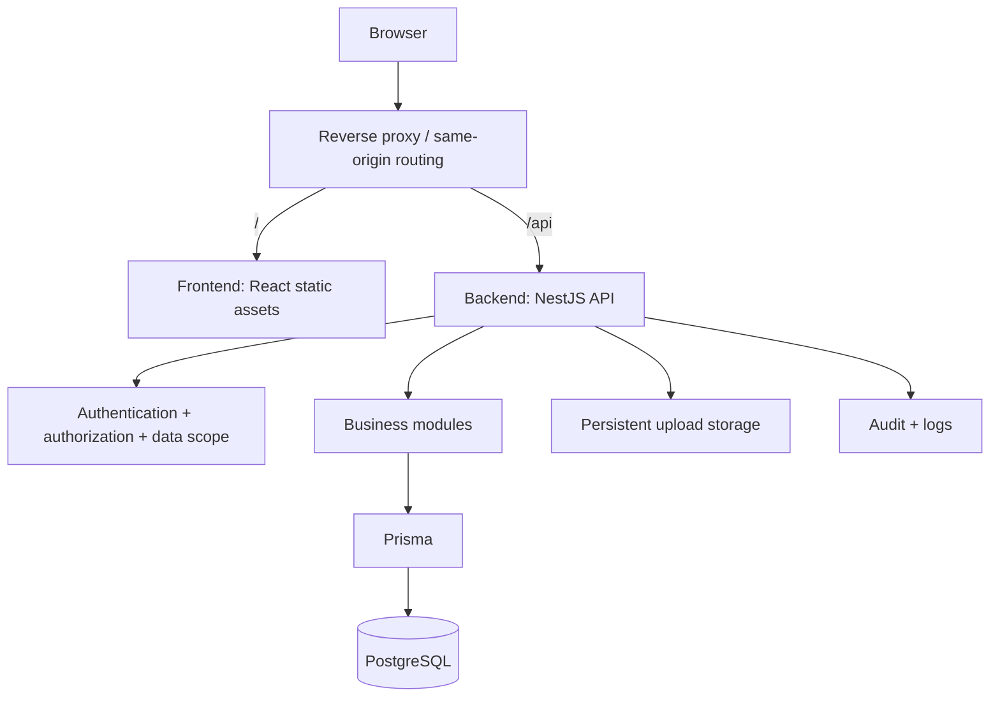
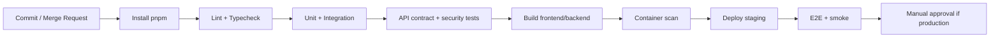

# Aura Talent Management — Kế hoạch chuyển đổi kiến trúc theo từng Stage
# Aura Talent Management — Stage-by-Stage Architecture Migration Plan

**Version:** 1.0  
**Date:** 2026-11-04  
**Status:** Proposed / Đề xuất  
**Target:** pnpm monorepo → independent React/Vite frontend + NestJS modular-monolith backend → Prisma/PostgreSQL  
**Project condition:** Testing, no production users / Đang thử nghiệm, chưa có người dùng production.

> **Evidence / Cơ sở:** `architecture-current.md` (phân tích tĩnh do dự án cung cấp), mô tả nghiệp vụ và stack do chủ dự án cung cấp. Chưa trực tiếp chạy mã nguồn, xem toàn bộ `package.json`, kiểm tra pipeline hay kiểm thử database. Tên scripts, paths, commands, API và cách auth cụ thể cần được xác nhận bằng source code trước khi thực thi. Nội dung được đánh dấu **Proposed** là thiết kế mục tiêu, không phải tính năng đã có.

---

## 0. Mục tiêu và nguyên tắc / Goals and rules

### Mục tiêu / Goals

1. Tách frontend và backend thành **hai ứng dụng độc lập trong một Git repository** (pnpm workspace); có dependencies, build, test, Dockerfile và cấu hình môi trường riêng.
2. Giữ nguyên hành vi hiện có: API contracts, JWT/refresh/session, RBAC và data scope, lịch, nhiệm vụ, phê duyệt, KPI, payroll, finance, upload và audit.
3. Sau khi tách thành công, chuyển Express sang NestJS theo từng module, **không rewrite đồng loạt**.
4. Giữ Prisma 6 + PostgreSQL 16 và migration history; không đổi schema chỉ vì chuyển framework.
5. Tạo kiểm thử và cổng nghiệm thu ở cuối từng stage; rollback bằng Git và khôi phục dữ liệu nếu có thay đổi dữ liệu.

**EN:** Separate applications before changing frameworks; preserve contracts and business behavior; migrate backend incrementally; validate and checkpoint each stage.

### Phạm vi không thực hiện / Out of scope

- Không đổi React/Vite sang Next.js; không đổi TypeScript sang Java.
- Không tách backend thành microservices, không thêm Redis/BullMQ nếu chưa có use case và phép đo rõ ràng.
- Không thay đổi công thức lương, KPI, chính sách nghỉ phép hoặc quy trình phê duyệt trong cùng PR migration.
- Không thay Prisma/PostgreSQL, không tự động xóa database, không chạy `prisma db push` thay cho migration quản lý phiên bản.

### Nguyên tắc bắt buộc / Non-negotiable guardrails

- **One change category per stage:** di chuyển file ≠ refactor nghiệp vụ ≠ đổi framework.
- **API compatibility:** giữ HTTP method, path, request/response, status, error codes, auth semantics, upload/download behavior; mọi thay đổi phải được phê duyệt.
- **Server is authoritative:** client không quyết định quyền, lương, KPI, phạt, trạng thái phê duyệt hay khóa kỳ.
- **Backup first:** backup PostgreSQL và `uploads/`, kiểm tra khả năng restore trước mọi thao tác có thể ảnh hưởng dữ liệu.
- **No stage skipping:** phải có bằng chứng kiểm thử và commit/tag tại mỗi gate.
- **No concurrent writers during cutover:** chỉ một backend được phép thực hiện mutations trên database tại một thời điểm, trừ khi đã chứng minh an toàn.
- **Security:** không commit secrets, không đưa Prisma Client hay database credentials vào frontend hoặc `packages/contracts`.

---

## 1. Hiện trạng và đích đến / Current state and target

### Hiện trạng đã được tài liệu mô tả / Documented current state

```text
repo/
├── src/                  # React SPA, views, components, api.ts
├── public/
├── server.ts             # Express startup, middleware, API routes
├── server/
│   ├── auth/             # authorization, jwt, password, session
│   ├── data/             # store, defaults
│   └── db/               # pgStore.ts, prisma.ts
├── prisma/               # schema, migrations, generated client
├── scripts/              # seed, preflight, migrations
├── uploads/              # uploaded files
├── docs/                 # API, architecture, security, database
├── test/
├── vite.config.ts
└── package.json
```

**Documented risks / Điểm tập trung:** `server.ts` tập trung routes/middleware; `server/db/pgStore.ts` tập trung truy cập dữ liệu và nghiệp vụ của nhiều phân hệ. Logic có thể nằm ở frontend utilities, route handlers và store. Đây là vấn đề tổ chức mã, **không phải bằng chứng hiệu năng kém**.

### Đích đến / Target layout (proposed)

```text
repo/
├── apps/
│   ├── frontend/
│   │   ├── src/
│   │   │   ├── components/
│   │   │   ├── features/             # optional, gradual
│   │   │   ├── services/
│   │   │   └── views/
│   │   ├── public/
│   │   ├── index.html
│   │   ├── vite.config.ts
│   │   ├── tsconfig.json
│   │   ├── package.json
│   │   └── Dockerfile
│   └── backend/
│       ├── src/
│       │   ├── main.ts
│       │   ├── app.module.ts
│       │   ├── common/              # guards, filters, pipes, interceptors
│       │   ├── infrastructure/      # prisma, logging, storage
│       │   └── modules/
│       │       ├── auth/
│       │       ├── users/
│       │       ├── personnel/
│       │       ├── scheduling/
│       │       ├── tasks/
│       │       ├── assignments/
│       │       ├── leave/
│       │       ├── approvals/
│       │       ├── kpi/
│       │       ├── payroll/
│       │       ├── finance/
│       │       ├── notifications/
│       │       └── audit/
│       ├── prisma/                  # canonical schema + migration history
│       ├── scripts/
│       ├── test/
│       ├── package.json
│       └── Dockerfile
├── packages/
│   └── contracts/                  # safe API types/schemas only
├── infra/
│   ├── compose.yaml
│   └── nginx/                      # optional reverse proxy
├── docs/
│   ├── migration/
│   └── ...
├── pnpm-workspace.yaml
├── pnpm-lock.yaml
├── package.json
└── .gitignore
```

**Note:** `apps/backend/prisma/` is the proposed canonical location; generated client output should be reproducible and excluded from version control if current project conventions allow. Actual scripts and paths must be adapted to the existing Prisma generator configuration. `packages/contracts` may initially remain empty until a stable shared contract is identified.

### Runtime architecture / Kiến trúc chạy



The frontend and backend can be independently built/deployed while remaining in one repository. Same-origin `/api` reverse proxy is recommended where feasible; separate domains are possible with explicit CORS/cookie/security design.

---

## 2. Stage overview / Tổng quan stage

| Stage | Name / Tên | Primary outcome / Kết quả | Gate |
|---|---|---|---|
| 0 | Discovery & baseline / Khảo sát | Inventory, backups, baseline tests | G0 |
| 1 | Monorepo foundation / Nền tảng workspace | Root pnpm workspace, scripts | G1 |
| 2 | Separate frontend / Tách frontend | React runs independently in `apps/frontend` | G2 |
| 3 | Separate Express backend / Tách Express | Express runs independently in `apps/backend` | G3 |
| 4 | Deployment & contracts / Triển khai và hợp đồng | Separate builds, Docker, API contract checks | G4 |
| 5 | NestJS foundation / Nền tảng NestJS | Nest bootstrap, shared infrastructure | G5 |
| 6 | Incremental domain migration / Chuyển từng phân hệ | Route-by-route Nest parity | G6 per module |
| 7 | Cutover & retire Express / Chuyển chính thức | Nest is sole active API | G7 |
| 8 | Hardening & closure / Hoàn thiện | Security, observability, docs, handover | G8 |

**Ordering rule:** Complete Stages 0–4 with Express still running before beginning Stage 5. The backend stays a modular monolith; frontend/backend become independent deployables.

---

## Stage 0 — Discovery, baseline & backups / Khảo sát, chốt hiện trạng và sao lưu

**Objective:** Capture what works today so later changes can be proven behavior-preserving.

### Steps / Các bước

- [ ] **0.1** Create branch `refactor/aura-monorepo-nestjs`; record commit SHA, package manager, Node/pnpm versions, OS, env file names, and current Docker Compose configuration.
- [ ] **0.2** Inventory root `package.json` scripts/dependencies; map which packages are frontend-only, backend-only, build-only, and shared.
- [ ] **0.3** Inventory Vite aliases, TS config paths, ESLint/test config, static assets, `src/services/api.ts`, and frontend auth/session handling.
- [ ] **0.4** Inventory `server.ts`: middleware order, all endpoints/methods, response schemas/status codes, authentication, authorization, rate limits, CORS, file uploads, static serving, error handlers and startup/shutdown.
- [ ] **0.5** Inventory `pgStore.ts`: exported functions, callers, Prisma transactions, raw queries, business rules, side effects, and dependencies on `server/data/`.
- [ ] **0.6** Inventory Prisma schema, generator output, migration history, seeds, production preflight, `scripts/` and any paths assumed relative to repository root.
- [ ] **0.7** Create an API contract snapshot (OpenAPI if available; otherwise a method/path/request/response table and fixtures). Include error responses, refresh-token behavior, upload/download.
- [ ] **0.8** Identify critical scenarios: login/refresh/logout, RBAC/data scope, personnel CRUD, scheduling, assignments, leave approvals, KPI scoring, payroll lock/adjustment, revenue/expense and audit.
- [ ] **0.9** Create a disposable test database with representative records. Backup important PostgreSQL data and `uploads/`; perform at least one restore rehearsal to an isolated environment.
- [ ] **0.10** Run and record existing typecheck, lint, unit/integration tests, frontend build, backend start and smoke tests. Record known failures as pre-existing rather than silently fixing them during migration.
- [ ] **0.11** Create `docs/migration/baseline.md`, `api-inventory.md`, `dependency-map.md`, `data-backup-restore.md`, `risk-register.md`.

### Suggested commands / Lệnh tham khảo

```bash
node --version
pnpm --version
pnpm install --frozen-lockfile
pnpm run                     # inspect available scripts first
pnpm exec prisma migrate status  # only if current Prisma config supports it
# pg_dump/pg_restore must use verified connection settings and a safe target.
```

### Acceptance gate G0

- [ ] All API routes and critical workflows documented.
- [ ] Baseline commands and outcomes recorded; known failures listed.
- [ ] DB and upload backup exists; isolated restore verified.
- [ ] No secrets committed; branch checkpoint created: `checkpoint/stage-0-baseline`.

**Rollback:** No production runtime changes; revert docs or branch as needed.

---

## Stage 1 — pnpm monorepo foundation / Thiết lập workspace

**Objective:** Introduce workspace tooling without moving application code yet.

### Steps

- [ ] **1.1** Create root `pnpm-workspace.yaml` and root package scripts; keep existing app commands working during transition.
- [ ] **1.2** Pin package manager in root `package.json` (`packageManager`) to the verified pnpm version; choose one supported Node version for local, CI and Docker (do not silently mix Node 24 and 22).
- [ ] **1.3** Define package names, e.g. `@aura/frontend`, `@aura/backend`, `@aura/contracts`; establish dependency direction (frontend → contracts; backend → contracts; contracts → neither app).
- [ ] **1.4** Define root scripts for `dev`, `build`, `test`, `typecheck`, `lint`, `db:migrate` using `pnpm --filter`, but only enable filters once package files exist.
- [ ] **1.5** Update `.gitignore` for per-app `dist`, caches, env files, logs, generated artifacts; preserve necessary tracked files.
- [ ] **1.6** Verify deterministic install and record lockfile changes; do not upgrade unrelated dependencies.

### Example files / Mẫu cấu hình (adjust to repo)

`pnpm-workspace.yaml`:

```yaml
packages:
  - 'apps/*'
  - 'packages/*'
```

Root `package.json` after app moves:

```json
{
  "name": "aura-talent-management",
  "private": true,
  "packageManager": "pnpm@10.33.0",
  "scripts": {
    "dev:frontend": "pnpm --filter @aura/frontend dev",
    "dev:backend": "pnpm --filter @aura/backend dev",
    "build": "pnpm -r --if-present build",
    "typecheck": "pnpm -r --if-present typecheck",
    "test": "pnpm -r --if-present test"
  }
}
```

> The package-manager version above reflects the version reported by the project owner; verify installed availability. These scripts are **target examples**, not a claim they work before Stages 2–3.

### Acceptance gate G1

- [ ] Install works with lockfile; baseline app still runs from original location.
- [ ] No unexpected dependency upgrades or application behavior changes.
- [ ] Commit `chore: initialize pnpm workspace`; tag `checkpoint/stage-1-workspace`.

**Rollback:** Revert Stage 1 commit; restore prior lockfile.

---

## Stage 2 — Separate frontend without rewriting / Tách frontend, không đổi nghiệp vụ

**Objective:** Move React/Vite to `apps/frontend/` while keeping existing Express server unchanged.

### Steps

- [ ] **2.1** Create `apps/frontend/` and its own `package.json`, TypeScript/Vite configuration and environment template.
- [ ] **2.2** Move `src/`, `public/`, `index.html`, Vite config and frontend-only configs; use `git mv` where possible to preserve history.
- [ ] **2.3** Update Vite aliases, `tsconfig` references, asset paths, lazy imports, CSS/Tailwind config and tests to new paths.
- [ ] **2.4** Move frontend-only dependencies to `@aura/frontend`; keep backend dependencies out of frontend package.
- [ ] **2.5** Configure `VITE_API_BASE_URL` or Vite dev proxy; ensure the client does not contain private secrets. Prefer same-origin `/api` for deployment.
- [ ] **2.6** Confirm `src/services/api.ts` still handles access token, 401 refresh and session expiry identically.
- [ ] **2.7** Confirm role-based navigation, dashboard, views, forms, file previews and browser routing still work.
- [ ] **2.8** Add `dev`, `build`, `preview`, `typecheck`, `test` scripts according to actual tooling.
- [ ] **2.9** Build frontend independently and inspect generated assets for accidental server-only imports or secrets.

### Acceptance gate G2

- [ ] `pnpm --filter @aura/frontend build` succeeds.
- [ ] Frontend starts independently; API requests reach unchanged Express backend.
- [ ] Auth/session/navigation and key workflows pass browser smoke tests.
- [ ] No changes to business formulas, DB schema or API behavior.
- [ ] Commit `refactor(frontend): isolate Vite application`; tag `checkpoint/stage-2-frontend`.

**Rollback:** Revert frontend move and associated paths; backend remains untouched.

---

## Stage 3 — Separate Express backend without framework change / Tách backend Express

**Objective:** Relocate the current Express API to `apps/backend/` without changing route semantics or business rules.

### Steps

- [ ] **3.1** Create `apps/backend/package.json`, TypeScript/tsx config and backend env template.
- [ ] **3.2** Move `server.ts`, `server/`, Prisma schema/migrations and backend-specific scripts/tests to `apps/backend/`; carefully classify scripts that belong at root.
- [ ] **3.3** Fix imports and filesystem paths: Prisma generator, migration working directory, seed scripts, static assets, `uploads/`, log paths, preflight scripts.
- [ ] **3.4** Keep upload storage **persistent and outside disposable container layers**; if moving files, migrate contents with checksum and backup.
- [ ] **3.5** Move backend dependencies into `@aura/backend`; configure `dev` (tsx), `build`, `start`, `typecheck`, `test`, `db:generate`, `db:migrate`.
- [ ] **3.6** Separate backend API from frontend static serving in deployment. During development, use Vite dev proxy; for production-like testing use Nginx/reverse proxy.
- [ ] **3.7** Confirm middleware order (body parser, CORS, auth, policy checks, rate limit, audit, errors) is unchanged.
- [ ] **3.8** Confirm Prisma Client generation and `prisma migrate status`; **do not create a new baseline or reset migration history**.
- [ ] **3.9** Validate backend can start with frontend stopped and frontend can build with backend stopped.
- [ ] **3.10** Run baseline API/integration tests against isolated DB and verify audit, uploads, login/refresh/logout and data scope.

### Acceptance gate G3

- [ ] Express API runs independently from `apps/backend`.
- [ ] Existing method/path/status/response and security behavior matches Stage 0 baseline.
- [ ] Prisma schema/history intact; DB not reset; uploads accessible.
- [ ] Frontend and backend have separate dependencies, build and start scripts.
- [ ] Commit `refactor(backend): isolate Express application`; tag `checkpoint/stage-3-backend`.

**Rollback:** Revert relocation; restore backed-up upload paths if needed. DB schema should not have changed.

---

## Stage 4 — Independent builds, deployment and contracts / Chuẩn hóa deploy và API contract

**Objective:** Stabilize the separated architecture **before** replacing Express.

### Steps

- [ ] **4.1** Add separate multi-stage Dockerfiles: static React build served by Nginx; Node runtime for Express API.
- [ ] **4.2** Define `infra/compose.yaml` with frontend, backend and PostgreSQL (for test/dev), healthchecks, networks, environment injection and persistent volumes.
- [ ] **4.3** Configure reverse proxy: `/` → frontend, `/api` → backend; handle SPA fallback and upload/download paths correctly.
- [ ] **4.4** Define frontend/backend environment matrices (local/test/staging); never put DB credentials in `VITE_*` variables.
- [ ] **4.5** Introduce `packages/contracts` only for stable shared DTOs, schemas or generated OpenAPI types; keep contracts free of server-only imports.
- [ ] **4.6** Establish API contract tests and negative authorization tests. Compare snapshots for statuses, errors and pagination, not just happy-path JSON.
- [ ] **4.7** Add CI jobs: install → lint/typecheck → unit/integration → build FE/BE → API contract → smoke. Use path-based optimization only after correctness is established.
- [ ] **4.8** Test independent frontend deployment, independent backend deployment and combined deployment; verify cache busting and rollback artifacts.
- [ ] **4.9** Document runbook: start, stop, migrate, backup/restore, release, rollback and troubleshooting.

### Acceptance gate G4

- [ ] Both apps independently build and start via documented commands.
- [ ] Docker Compose environment passes end-to-end smoke tests.
- [ ] No unintended CORS, cookie, token, upload or SPA routing regressions.
- [ ] API contract baseline is automated and CI passes.
- [ ] Commit `build: independent app deployment and contracts`; tag `checkpoint/stage-4-express-stable`.

**Rollback:** Redeploy previously built frontend/backend images; restore prior reverse proxy config. No schema changes expected.

---

## Stage 5 — NestJS foundation alongside Express / Xây nền tảng NestJS song song

**Objective:** Prepare NestJS without immediately replacing the working Express API.

### Strategy / Chiến lược

Create a temporary NestJS implementation within the backend workspace (e.g. `apps/backend/nest/` or a temporary `apps/backend-nest/` package), using a separate port and **test database**. Choose the final folder approach after examining existing build scripts. Avoid two independent Prisma migration owners. In Stage 7, Nest becomes the canonical `apps/backend` runtime.

### Steps

- [ ] **5.1** Bootstrap NestJS with the project's supported TypeScript/Node versions and compatible package versions; avoid unrelated upgrades.
- [ ] **5.2** Implement `AppModule`, config validation, global validation pipe, exception filter, request ID, structured logging, health/liveness/readiness endpoints and graceful shutdown.
- [ ] **5.3** Add Prisma provider/service using the **existing canonical schema and migrations**; test connection lifecycle and transaction support.
- [ ] **5.4** Port authentication primitives (password hashing, JWT signing/verification, refresh tokens, sessions) with exact parity; do not redesign token formats as part of migration.
- [ ] **5.5** Implement authorization guards/policies with **role + action + resource + data scope** checks; ensure checks also apply to repository queries.
- [ ] **5.6** Port error response mapping, audit logging and upload abstraction, preserving public API semantics.
- [ ] **5.7** Add isolated integration tests for auth, unauthorized/forbidden access, refresh, expired sessions and ownership/department scope.
- [ ] **5.8** Create a routing ownership table: each route belongs to Express **or** Nest; no ambiguous duplicate mutations.
- [ ] **5.9** Define temporary routing method: API gateway/reverse proxy routes selected prefixes to Nest; all remaining prefixes to Express. Alternatively migrate via one cutover per module in staging. Avoid mounting Express and Nest in the same process unless carefully justified.

### Acceptance gate G5

- [ ] Nest starts independently; health and Prisma checks pass on test DB.
- [ ] Auth/security behavior matches baseline for selected tests.
- [ ] Existing Express remains available and unchanged; Nest not exposed as primary API yet.
- [ ] Routing ownership and rollback documented.
- [ ] Commit `feat(backend): NestJS foundation`; tag `checkpoint/stage-5-nest-foundation`.

**Rollback:** Stop Nest process/remove temporary proxy routes; continue using stable Express backend.

---

## Stage 6 — Domain-by-domain NestJS migration / Chuyển từng phân hệ

**Objective:** Replace Express endpoints incrementally with NestJS modules while preserving behavior.

### Mandatory per-module playbook / Quy trình bắt buộc cho mỗi module

For **every module**:

1. **Inventory:** list Express endpoints, handlers, `pgStore` calls, models, permissions, data-scope filters, audit events, side effects, error cases.
2. **Characterization tests:** capture current behavior against isolated test data, including negative/security and boundary cases.
3. **Extract business rules:** move logic into pure functions/services where feasible without changing outputs.
4. **Nest implementation:** controller → DTO validation → service → repository/Prisma, with module-specific policies.
5. **Contract parity:** compare request/response, status codes, errors, pagination, filtering, sorting, date/time handling and upload behavior.
6. **Transaction parity:** confirm atomicity, unique constraints, optimistic/concurrency checks and audit side effects.
7. **Staging routing:** direct only that module's routes to Nest; ensure one mutation owner.
8. **Regression:** execute frontend E2E plus backend tests; record results and known differences.
9. **Checkpoint:** commit/tag module and document rollback route.

### Proposed order / Thứ tự đề xuất

| Wave | Module(s) | Specific checks / Kiểm tra trọng tâm |
|---|---|---|
| 6A | Reference data, departments, users/personnel | CRUD, uniqueness, role/data scope, pagination |
| 6B | Scheduling, shifts, tasks, assignments | time zones, overlaps, task ownership, status transitions |
| 6C | Leave requests, approvals, notifications | multi-step approval, cancellation, notifications, idempotency |
| 6D | KPI, scoring, ranking | formulas, weights, period boundaries, deterministic rounding |
| 6E | Payroll, disputes, deductions | payroll lock, immutability, corrections, precision, concurrency |
| 6F | Revenue, expenses, finance, reporting | financial transactions, access scope, reconciliation, audit |
| 6G | Admin settings, remaining APIs, uploads | config security, upload validation, audit completeness |

**Important:** Auth foundation is implemented in Stage 5, but any remaining auth endpoints must be fully cut over and regression-tested before retiring Express. Exact wave boundaries depend on discovered dependency graph; move a tightly coupled group together when necessary.

### Special requirements for sensitive modules / Nghiệp vụ nhạy cảm

**Payroll:**
- [ ] Recalculate the same period in Express and Nest using identical fixture snapshots; compare exact decimal outputs.
- [ ] Prevent editing locked periods at the API/service/transaction layer, not only UI.
- [ ] Define authorized adjustment workflow instead of mutating locked records.
- [ ] Test simultaneous approvals, lock attempts, retries and audit records.

**KPI:**
- [ ] Compare scoring, weight totals, period boundaries, penalties/exemptions and ranking tie rules.
- [ ] Explicitly test timezone and rounding behavior; avoid accidental JavaScript floating-point changes.

**Authorization:**
- [ ] Test same-role cross-department access, direct-object-ID access, self-service views, disabled accounts, revoked sessions.
- [ ] Verify queries cannot leak records outside authorized scope even when UI hides those records.

**Approvals/assignments:**
- [ ] Verify legal state transitions and duplicate/replayed request handling.
- [ ] Preserve side effects on scheduling/KPI and notification behavior.

### Acceptance gate G6 (repeat for each module)

- [ ] All owned routes pass API contract tests.
- [ ] All relevant authorization, business and transaction tests pass.
- [ ] No unexpected schema migration; if required, approved and independently tested.
- [ ] Module-specific frontend E2E passes; no double writes.
- [ ] Commit `refactor(nest): migrate <module>`; tag `checkpoint/stage-6-<module>`.

**Rollback:** Route that module back to Express, redeploy prior version; assess data compatibility before reverting if a schema or data transformation was introduced.

---

## Stage 7 — Full cutover and Express retirement / Chuyển hoàn toàn sang NestJS

**Objective:** Make Nest the sole API backend and remove legacy Express only after complete parity.

### Steps

- [ ] **7.1** Confirm route ownership inventory has zero remaining Express endpoints, including health, auth, upload, admin and obscure legacy routes.
- [ ] **7.2** Run full test matrix on a restored staging copy with representative data; verify database migration status.
- [ ] **7.3** Freeze changes during cutover; backup DB/uploads; capture running image digests and proxy config.
- [ ] **7.4** Switch reverse proxy/backend service to Nest; ensure old Express is stopped or read-only and cannot write concurrently.
- [ ] **7.5** Run immediate smoke tests: login, refresh, CRUD, permission denial, schedule, KPI, payroll lock, finance, uploads, audit, health.
- [ ] **7.6** Check logs, request IDs, error rates, DB connections, latency and resource consumption against baseline.
- [ ] **7.7** Remove Express runtime code/dependencies and temporary routing only after stable verification; retain migration branch/tag history.
- [ ] **7.8** Update scripts, Dockerfile, CI/CD, docs and API contracts to canonical NestJS `apps/backend`.

### Acceptance gate G7

- [ ] Nest serves 100% of documented API endpoints.
- [ ] No unauthorized access or cross-scope data exposure in tests.
- [ ] All critical business scenarios pass with expected results.
- [ ] Express is not running as a writer; backups and rollback artifacts verified.
- [ ] Commit `refactor: retire Express backend`; tag `checkpoint/stage-7-nest-cutover`.

### Rollback decision / Quyết định rollback

- **Before schema/data changes:** redeploy last stable Express image and restore proxy routing.
- **After schema/data changes:** do not blindly revert application binaries; first confirm backward compatibility or restore a verified snapshot to an isolated target. Prefer backward-compatible expand/contract migrations and forward fixes.
- **Never** automatically restore an old DB backup over a database containing newer legitimate writes without an explicit data-loss decision.

---

## Stage 8 — Hardening, operational readiness and closure / Hoàn thiện và bàn giao

**Objective:** Make the new architecture maintainable, secure and operable.

### Steps

- [ ] **8.1** Review security: JWT/session lifetime, password storage, RBAC/data scope, rate limiting, CORS, CSRF where applicable, secure headers, upload limits/type validation, secret management.
- [ ] **8.2** Validate DB: connection pool sizing, transaction boundaries, indexes from measured query patterns, migration deploy process and backup/restore.
- [ ] **8.3** Add observability: structured logs, request/correlation IDs, audit events, health/readiness, metrics and alerting appropriate to deployment.
- [ ] **8.4** Verify Docker runtime security, non-root containers where feasible, image scanning, pinned base images and resource requests/limits.
- [ ] **8.5** Implement CI/CD gates: lint, typecheck, unit, integration, API contract, E2E smoke, build, security scan and deployment validation.
- [ ] **8.6** Verify independent frontend/backend release and rollback, DB migration ordering and artifact retention.
- [ ] **8.7** Update `docs/architecture/`, API specs, security docs, ERD, operational runbooks and onboarding instructions.
- [ ] **8.8** Remove stale configs, unused packages and dead code; do not remove archived migration records needed for audit/recovery.
- [ ] **8.9** Conduct final review and sign off on functional parity, security and recovery readiness.

### Acceptance gate G8

- [ ] Reproducible setup from clean checkout.
- [ ] Independent frontend/backend builds and deployments verified.
- [ ] Security and regression suites pass.
- [ ] Restore rehearsal and rollback runbook documented.
- [ ] Final architecture and module ownership documented.
- [ ] Tag `release/aura-nestjs-monorepo-v1` (or team's approved naming convention).

---

## 3. Test matrix / Ma trận kiểm thử xuyên suốt

| Test group | Minimum required coverage / Phạm vi tối thiểu | Stages |
|---|---|---|
| Build/type | frontend/backend install, typecheck, build | 0–8 |
| Authentication | login, logout, refresh, expiry, disabled account | 0,2–8 |
| Authorization | role/action/data scope, IDOR, forbidden access | 0,3–8 |
| API contracts | methods, paths, schemas, status/error, pagination | 0,3–8 |
| Personnel | create/update/read, uniqueness, department scope | 0,2–8 |
| Scheduling/tasks | shift overlaps, due dates, task status, assignments | 0,2–8 |
| Leave/approvals | approve/reject/cancel, state transition, replay | 0,2–8 |
| KPI | scoring, weights, ranking, time period, rounding | 0,2–8 |
| Payroll | calculation, locks, adjustments, concurrency, audit | 0,2–8 |
| Finance | revenue/expense, transaction integrity, scope | 0,2–8 |
| Upload | file type/size, persistence, retrieval, permissions | 0,2–8 |
| Operations | health, graceful shutdown, logs, backups, restore | 0,3–8 |

**Test data:** use sanitized or synthetic fixtures; do not copy sensitive personnel/payroll data into unsecured developer environments. Prefer deterministic clocks/time zones for payroll and scheduling tests.

---

## 4. CI/CD proposal / Đề xuất pipeline



**Recommended jobs / Job đề xuất:** `validate-workspace`, `frontend-check`, `backend-check`, `contracts-check`, `integration-postgres`, `frontend-build`, `backend-build`, `docker-build`, `security-scan`, `staging-deploy`, `smoke-test`. During Stage 6 run Express-vs-Nest contract comparison as a temporary migration gate.

**Dependency-sensitive CI:** a change in `packages/contracts` must trigger both frontend and backend checks; a change in Prisma schema must trigger backend checks and migration validation. Avoid assuming path filters are sufficient without dependency awareness.

---

## 5. Risk register / Danh sách rủi ro

| Risk / Rủi ro | Impact | Prevention / Phòng ngừa | Recovery / Khôi phục |
|---|---|---|---|
| Broken import/path after move | Medium | isolated stages, builds, smoke | revert stage commit |
| Prisma migration history lost | Critical | preserve schema/migrations, status check | restore files/history; never reset blindly |
| JWT/session incompatibility | High | auth characterization tests | route back to Express |
| Data-scope authorization regression | Critical | negative tests, query-level policy checks | stop cutover, revert routing |
| Payroll/KPI formula drift | Critical | golden fixtures, exact decimals, edge cases | revert module; reconcile records |
| Duplicate writes during dual runtime | Critical | single writer per route, routing ownership | disable secondary writer, reconcile |
| Upload file loss | High | persistent volume, backup, checksums | restore uploaded files |
| CORS/proxy/cookie mismatch | Medium | same-origin design, E2E browser tests | restore proxy config |
| Node/runtime mismatch | Medium | pin/test same supported Node version | revert image/runtime |
| Incompatible DB rollback | Critical | expand/contract migrations, rehearsal | forward fix or controlled restore |

---

## 6. Stage deliverables / Hồ sơ bàn giao từng stage

Every stage must produce:

1. **Change summary / Tóm tắt thay đổi:** paths moved, packages changed, API/schema changes (or explicit “none”).
2. **Test evidence / Bằng chứng:** commands, results, screenshots/log excerpts if relevant, failures and waivers.
3. **Risk & rollback / Rủi ro và rollback:** tested revert steps, DB implications.
4. **Commit/tag / Mốc Git:** immutable checkpoint.
5. **Gate sign-off / Nghiệm thu:** reviewer, date, decision (PASS / BLOCKED / PASS WITH WAIVER).

Suggested `docs/migration/stage-N-report.md`:

```markdown
# Stage N report
- Scope:
- Base commit / target commit:
- Files moved / changed:
- API changes: None / documented list
- Database schema changes: None / migration ID
- Commands executed and outcomes:
- Security / authorization tests:
- Business regression tests:
- Known issues:
- Rollback tested:
- Gate decision: PASS / BLOCKED / WAIVER
```

---

## 7. Execution guidance for AI coding agents / Hướng dẫn giao việc cho AI agent

**One stage per task / Mỗi lần chỉ giao một stage.** Do not ask the agent to simultaneously reorganize directories, migrate all routes, change database schema and rewrite business logic.

### Reusable prompt / Prompt mẫu

```text
You are implementing Stage <N> of docs/migration/aura-talent-staged-migration-plan.md.
Read architecture-current.md, the current code, and Stage <N> acceptance criteria.
First produce a concrete file-by-file change plan and identify risks.
Do not modify business rules, API contracts, Prisma schema, migrations,
JWT/session semantics, RBAC/data scope or payroll/KPI calculations unless
this stage explicitly authorizes it.
Make small reviewable changes. Run relevant tests and builds.
At completion report: files changed, commands/results, deviations,
remaining risks, rollback steps and whether the acceptance gate passes.
Do not proceed to the next stage automatically.
```

**VI:** Agent phải đọc mã nguồn thực tế, không suy diễn scripts hoặc đường dẫn. Chỉ được tiếp tục khi gate hiện tại đạt PASS và người phụ trách đồng ý.

---

## 8. Final go/no-go checklist / Checklist quyết định hoàn tất

- [ ] Two independent applications in one pnpm workspace.
- [ ] Frontend stays React/Vite; backend is NestJS modular monolith.
- [ ] Prisma schema and migration history preserved and validated.
- [ ] All documented API contracts remain compatible or approved exceptions are versioned.
- [ ] Auth, RBAC and data-scope regression tests pass.
- [ ] KPI/payroll/finance results match accepted fixtures.
- [ ] Uploads, audit, request IDs, health and graceful shutdown work.
- [ ] Independent build/deploy/rollback works for frontend and backend.
- [ ] Backup/restore and migration rollback procedures are rehearsed.
- [ ] Express runtime removed only after full Nest cutover.
- [ ] Documentation, CI/CD and release checklist updated.

**Final decision / Quyết định:** **Separate first → validate → introduce NestJS foundation → migrate domain by domain → cut over → harden.**

---

## 9. References / Tài liệu tham chiếu

- `architecture-current.md` — user-supplied static architecture description; source for existing paths, flow and known structural concentration.
- `aura-talent-architecture-migration-proposal.md` — previous proposed target architecture and migration rationale.
- User-provided Aura business description and stack versions — context, not independent runtime verification.

**Important limitation:** This plan is a proposed implementation roadmap, not a claim that any stage has been executed. Before coding, reconcile it with the actual repository, CI/CD configuration, tests and deployment environment.
